<div align="center">


# MG4Dash

**Simply your Dash**

[English](README.md) · **Français**

</div>

MG4Dash remplace l'écran d'accueil de la **MG4** par un tableau de bord plein écran conçu pour son écran 1920 × 720 : climatisation, batterie et autonomie, une carte ou l'appli de votre choix, la météo et les médias sur un seul écran, plus des pages Climatisation, Énergie, Véhicule, Son et Téléphone. Chaque carte peut être déplacée ou remplacée, et tout l'affichage suit les feux de la voiture, en mode sombre, clair ou automatique.

Il fonctionne sur tous les firmwares d'autoradio de la MG4 (SWI69, SWI131/132/173, SWI68, SWI133, SWI165), en français, anglais, allemand, espagnol, italien, néerlandais, turc et tchèque, en km ou en miles. C'est un logiciel libre, fait par un propriétaire de MG4, pas par SAIC / MG.

> [!NOTE]
> Dernière version stable : **1.7.3** ([versions](https://github.com/Skittle6938/MG4Dash/releases)). Cette page décrit la version actuelle de `main`, publiée en bêtas 1.7.4. Certaines fonctions ci-dessous ne sont pas encore dans la 1.7.3 : activez *Inclure les versions bêta* dans l'appli pour les avoir ([Mises à jour](#mises-à-jour-sauvegardes-et-applis-compagnons)).

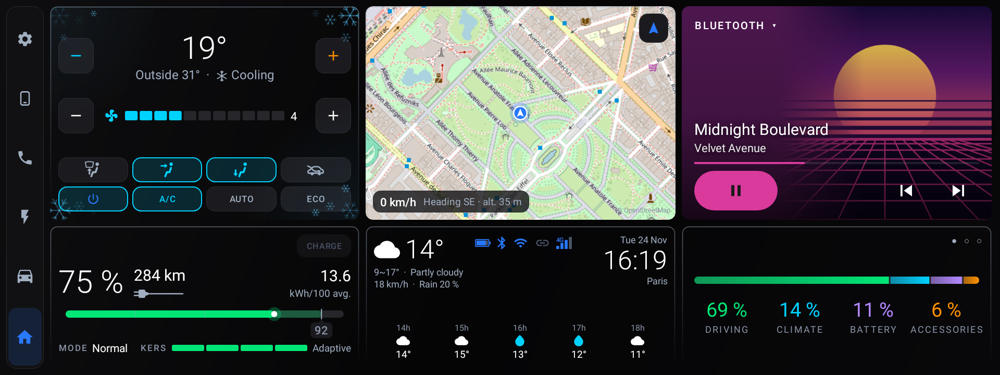

## Sommaire

1. [Avant d'installer](#avant-dinstaller)
2. [Installer MG4Dash](#installer-mg4dash)
3. [Premiers pas](#premiers-pas)
4. [L'écran d'accueil](#lécran-daccueil)
5. [Les cartes et ce qu'elles affichent](#les-cartes-et-ce-quelles-affichent)
6. [Organiser l'accueil](#organiser-laccueil)
7. [Menu de raccourcis](#menu-de-raccourcis)
8. [Médias, radio et Android Auto](#médias-radio-et-android-auto)
9. [Pages : climatisation, énergie, véhicule, son, téléphone, trajets](#pages--climatisation-énergie-véhicule-son-téléphone-trajets)
10. [Réglages](#réglages)
11. [Apparence : thèmes, couleurs et luminosité](#apparence--thèmes-couleurs-et-luminosité)
12. [Profils](#profils)
13. [Avertisseur de radars](#avertisseur-de-radars)
14. [Mises à jour, sauvegardes et applis compagnons](#mises-à-jour-sauvegardes-et-applis-compagnons)
15. [Mode Entretien et retour à l'accueil SAIC](#mode-entretien-et-retour-à-laccueil-saic)
16. [Gestes](#gestes)
17. [Dépannage](#dépannage)
18. [Créer et proposer une carte d'accueil (widget)](#créer-et-proposer-une-carte-daccueil-widget)
19. [Compiler MG4Dash](#compiler-mg4dash)
20. [Remerciements, soutien et licence](#remerciements-soutien-et-licence)

## Avant d'installer

| Il faut | Pourquoi |
|---|---|
| Une MG4 avec l'autoradio 1920 × 720 | L'affichage est conçu pour cet écran. |
| Une connexion de données dans la voiture (4G ou Wi-Fi) | Seulement pour la carte, la météo, les mises à jour et les données radars. Tout ce qui concerne la voiture marche hors ligne. |

**Firmwares pris en charge** : MG4Dash lit le firmware au démarrage (`ro.build.mt2712.version`) et parle à la voiture comme ce firmware le permet. Une fonction que le firmware n'expose pas est masquée au lieu d'échouer.

| Firmware | État | Remarques |
|---|---|---|
| SWI69 | Testé chaque jour par l'auteur | Tout fonctionne, y compris [MG4Radio](https://github.com/Skittle6938/MG4Radio). |
| SWI131, SWI132, SWI173 | Bêta, même accès voiture que SWI69 | SWI173 signalé dans [#33](https://github.com/Skittle6938/MG4Dash/issues/33) et [#35](https://github.com/Skittle6938/MG4Dash/issues/35). |
| SWI68 | Bêta, testé par des utilisateurs ([#19](https://github.com/Skittle6938/MG4Dash/issues/19)) | Clim, charge, V2L, radio et aides à la conduite via le SDK du launcher d'origine. Pas de MG4Radio. |
| SWI133 | Bêta ([#13](https://github.com/Skittle6938/MG4Dash/issues/13)) | Comme SWI68 ; batterie et autonomie lues dans les propriétés de la voiture. Pas de MG4Radio. |
| SWI165 | Bêta, testé par des utilisateurs ([#28](https://github.com/Skittle6938/MG4Dash/issues/28), [#37](https://github.com/Skittle6938/MG4Dash/issues/37)) | Comme SWI68. Pas de MG4Radio. |

<details>
<summary>Ce qui change d'un firmware à l'autre, et comment aider à prendre en charge le vôtre</summary>

- **Limite de charge** : affichée seulement là où la voiture l'applique elle-même. MG4Dash ne peut pas arrêter une charge à la place de la voiture : il est éteint quand la voiture est verrouillée.
- **Barres de réseau mobile** : il faut une T-box lisible, elles manquent donc sur les anciens firmwares.
- **Anciens firmwares** (SWI68, SWI133, SWI165) : le launcher d'origine ouvre son propre écran clim ; MG4Dash peut revenir devant (réglages de la carte clim).
- **MG4Radio** ne fonctionne que sur SWI69, où elle remplace la radio d'origine.
- **Moteur web récent** (pour la carte Web app) : Android 9, 64 bits, avec la WebView signée avec la clé de test AOSP.

Tous les firmwares MG4 partagent l'écran et la clé plateforme AOSP : le même APK s'installe sur chacun.

Pour aider à prendre en charge votre firmware, ouvrez Réglages › **Système** › *Diagnostic* › *Lancer le test*, puis scannez le QR code avec votre téléphone. Il ouvre une [issue de compatibilité](https://github.com/Skittle6938/MG4Dash/issues/new?template=compatibility.md) pré-remplie avec un court rapport : versions, services de la voiture qui répondent et quelques mesures. Elle ne contient ni position, ni VIN, ni compte, et rien n'est envoyé automatiquement.

</details>

## Installer MG4Dash

1. **La première installation** : le dernier `MG4Dash-<version>.apk` des [versions](https://github.com/Skittle6938/MG4Dash/releases) doit être posé une fois sur l'autoradio par un développeur ayant un accès ADB. Ensuite, tout passe par les boutons de l'appli.
2. **Faites-en l'écran d'accueil** : dans MG4Dash, touchez la **roue dentée** de la barre, ouvrez l'onglet **Système** et touchez **Remplacer l'accueil SAIC**. MG4Dash s'ouvre maintenant au démarrage et avec le bouton Accueil de la voiture.
3. **Les mises à jour** viennent ensuite de l'appli elle-même : Réglages › **Système** › *Installer* ([Mises à jour](#mises-à-jour-sauvegardes-et-applis-compagnons)).

**Rien n'est désinstallé.** *Remplacer l'accueil SAIC* empêche seulement l'accueil SAIC d'être l'écran d'accueil. L'appli du launcher SAIC reste installée, et son service continue de gérer la caméra, les sources audio et la barre système. Vous pouvez revenir en arrière à tout moment avec le [Mode Entretien](#mode-entretien-et-retour-à-laccueil-saic).

> [!IMPORTANT]
> **MG4Dash Rescue**, une petite appli compagnon, est installée par MG4Dash lui-même. Si MG4Dash est votre écran d'accueil et ne démarre pas après un démarrage ou une mise à jour, Rescue le recompile et le relance, et remet l'accueil SAIC si cela ne suffit pas. Pendant qu'il optimise MG4Dash après une mise à jour, il affiche un écran *Mise à jour de MG4Dash…* aux couleurs de votre thème (à partir de Rescue 9). Si MG4Dash n'est pas votre écran d'accueil, Rescue ne fait rien.

## Premiers pas

- **Le tuto des gestes** s'ouvre après la première installation et montre les gestes principaux en quelques étapes (*Passer* le ferme pour de bon). Revoyez-le dans Réglages › **Écran** › *Revoir le tuto des gestes*. Refaites-le après chaque mise à jour stable : chaque version ajoute des gestes pas toujours faciles à deviner.
- **Appui long sur une carte** pour ses réglages. La plupart des réglages sont maintenant là où ils agissent : dans la fenêtre de la carte, pas dans la page Réglages.
- **Pincez l'accueil** à deux doigts pour choisir quelles cartes s'affichent où.
- **Glissez un doigt vers le bas depuis le haut** de l'écran pour le menu de raccourcis (antibrouillard, ESP, aides à la conduite, luminosité…).
- **Les réglages** sont derrière la roue dentée de la barre ; un appui long dessus ouvre les réglages de la voiture.

> Les captures de cette page sont rendues sur PC avec des données simulées et les réglages par défaut, sauf mention contraire. Elles montrent l'appli en anglais.

## L'écran d'accueil

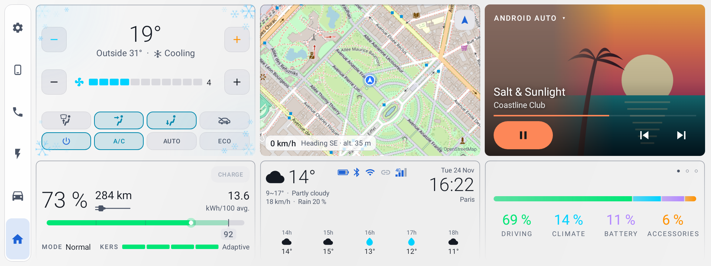

L'accueil par défaut (style *Standard*, disposition *Complète*) affiche, de gauche à droite :

- **La barre** : Réglages, Téléphone, Énergie, Véhicule et Accueil, verticale côté conducteur par défaut. Chaque icône a aussi un appui long ou un double appui, voir [Gestes](#gestes).
- **Climatisation** : température de consigne et température extérieure, ventilation, marche, A/C, AUTO, ECO, diffusion de l'air et recyclage, et sièges et volant chauffants sur les voitures équipées.
- **Énergie** : % de batterie au dixième, autonomie, consommation moyenne, mode de conduite et jauge de régénération.
- **Application** : la carte OpenStreetMap qui suit la voiture, ou une autre appli de votre choix.
- **Météo** : prévisions pour la position de la voiture, par heure ou par jour, avec les icônes de connexion.
- **Média** : la source en cours, avec son image.
- **Trajet, puissance ou téléphone** : la carte en bas à droite ; balayez-la pour passer à la suivante.

MG4Dash est toujours en plein écran : la barre latérale SAIC et la barre du haut restent cachées, y compris pendant les appels.

<details>
<summary>La carte Climatisation en détail</summary>

- Ventilation moins à la vitesse la plus basse : la clim s'éteint ; un appui long dessus passe directement à la vitesse la plus basse.
- Appui long sur **A/C** pour la clim intermittente : le compresseur tourne et se repose par cycles ; touchez A/C pour arrêter.
- Touchez la zone de température pour la page Climatisation.
- Appui long sur le bouton marche pour la [Clim maintenue](#clim-maintenue).
- **Appui long sur la carte** pour ses réglages : calibration de la température affichée (−5° à +5°, affichage seulement), durées des cycles de la clim intermittente, chauffage / refroidissement affiché sur la carte, *Sièges et volant chauffants* (auto, oui, non), *Clim maintenue*, et sur les anciens firmwares *Garder MG4Dash devant l'écran clim SAIC*.

</details>

<details>
<summary>La carte Énergie en détail : autonomie, sources de consommation et puissance en direct</summary>

La **barre d'autonomie** est verte, orange sous 30 % et rouge sous 15 % ; le % au départ du trajet y est marqué.

Une touche sur la moitié droite de la carte change la consommation affichée, et l'autonomie suit. Un petit logo indique laquelle est affichée :

| Logo | Consommation | Autonomie |
|---|---|---|
| éclair | depuis la dernière charge | énergie restante ÷ cette consommation |
| route | trajet en cours | idem |
| direct | le dernier km, glissant | idem, elle bouge davantage |
| voiture | celle que suppose l'autonomie de la voiture | l'autonomie de la voiture |

L'énergie restante est le niveau de charge × la santé estimée de la batterie × la capacité utile neuve (page Énergie). Une consommation pas encore connue (moins de 0,5 km) affiche « — ». L'énergie est mesurée chaque seconde à partir de la tension × le courant de la batterie, régénération déduite.

**Appui long sur la carte** pour ses réglages :

- *Puissance en direct dans la carte énergie* : une barre de puissance en direct remplace le mode de conduite et la jauge.
- *Tension et courant sous la barre de puissance*.
- La pile de la disposition Carte qui revient à la batterie quand la voiture est branchée.
- *Démarrer le V2L au branchement du câble*.

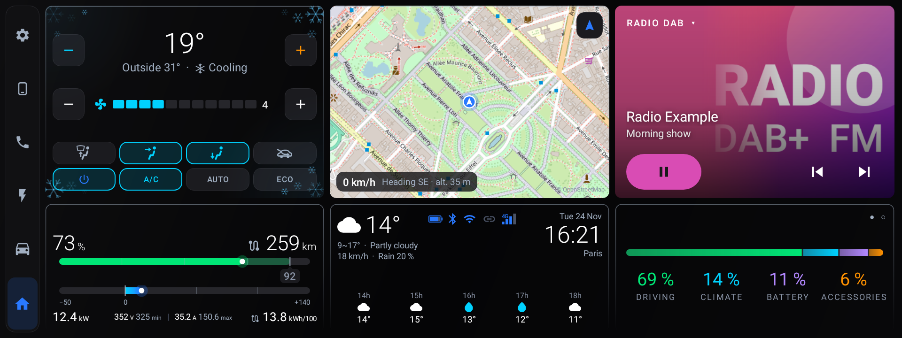

</details>

## Les cartes et ce qu'elles affichent

Chaque emplacement de l'accueil contient une ou plusieurs cartes ; un balayage sur un emplacement affiche sa carte suivante. Appui long sur une carte pour ses réglages.

| Carte | Ce qu'elle affiche | Appui long |
|---|---|---|
| **Climatisation** | Température, ventilation, air, sièges chauffants | calibration, clim intermittente, Clim maintenue |
| **Énergie** | Batterie, autonomie, consommation, mode de conduite, régénération | puissance en direct, tension et courant, V2L |
| **Application** (carte) | Carte OpenStreetMap qui suit la voiture, ou une autre appli | zoom, couleurs de la carte, passage hors ligne ; menu des applis |
| **Consommation** | Courbes de consommation par trajet, depuis la dernière charge ou sur 12 mois | périodes, consommation à l'arrêt, effacer la courbe |
| **Raccourcis** | Applis et actions Home Assistant | Réglages Home Assistant |
| **Web app** | Une page web de votre choix (un tableau de bord Home Assistant, ABRP…) | ses adresses |
| **Par heure / Par jour** | Prévisions Open-Meteo | modèle météo, ville de repli |
| **Trajet** | Énergie du trajet : conduite, clim et accessoires | |
| **Puissance** | kW en direct, pic, moyenne ; effets à pleine accélération | MG4 XPower, effets et leur son |
| **Téléphone** | Contacts favoris ; touchez pour appeler | |
| **Derniers trajets** | Trajet en cours, trajets précédents, aujourd'hui | |
| **Conduite** | Mode de conduite, régénération, direction et pédale de frein du mode Custom, maintien de voie et alerte de collision, modifiables depuis la carte | |
| **Avertisseur** | Limitation de vitesse et zones de radars | [tout l'avertisseur](#avertisseur-de-radars) |
| **Guidage** | Guidage pas à pas de MG4Link / Headunit Revived | |
| **Paroles** | Paroles de la chanson en cours, synchronisées quand c'est possible ; un toucher ouvre la vue karaoké | Wi-Fi uniquement, cache, décalage des paroles, pastille flottante et sa ligne précédente |
| **Chrono** | Chronométrage du 0-50, 0-100 et 80-120 km/h, 10 derniers essais et records | mode Sport et clim coupée pendant l'essai, historique, courbe de puissance de chaque essai |
| **Mémos vocaux** | Enregistre des mémos vocaux, même quand un autre écran est affiché | réécouter, renommer, supprimer, copier ou déplacer sur une clé USB, réglages d'enregistrement |

Paroles, Chrono et Mémos vocaux sont optionnelles : placez-les depuis le mode édition de l'accueil.

| | | |
|---|---|---|
| 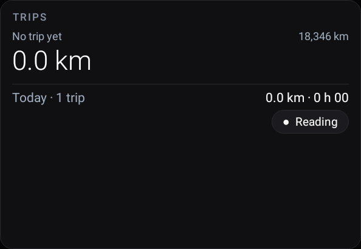 | 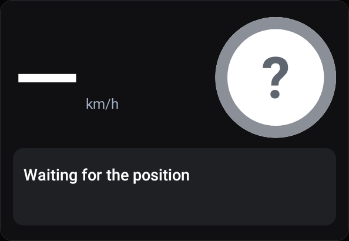 | 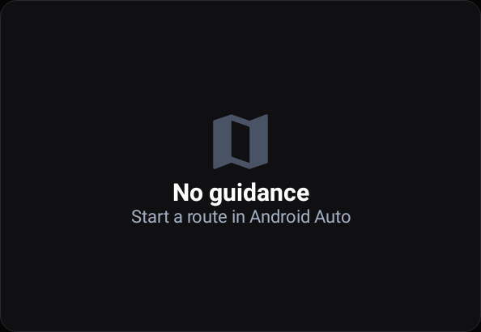 |

<details>
<summary>La carte Application : la carte, une autre appli, le plein écran et la fenêtre détachée</summary>

- **Carte** : suit la voiture, nord en haut ou cap en haut (touchez à nouveau le bouton de recentrage). Au repos, un balayage à un doigt change de carte ; touchez la carte une fois pour la réveiller (son contour s'allume), puis un doigt la déplace et deux doigts zooment. Sans connexion de données, la carte reste tant que la zone est en cache, puis l'accueil peut passer à la carte énergie (optionnel).
- **Une autre appli** : appui long sur la carte, puis choisissez la carte OpenStreetMap, une des 3 dernières applis ou *Autre application…*, par exemple ABRP ou Waze. Elle tourne en direct dans la carte et se repose et se réveille comme la carte.
- **Plein écran** : un double appui agrandit la carte sur tout l'écran ; un double appui, Accueil ou n'importe quel bouton de la barre la remet en place.
- **Fenêtre détachée** (désactivée par défaut) : dans le mode édition, *Double tap sur l'application › Fenêtre détachée* fait sortir la carte de son emplacement dans une fenêtre au-dessus de l'accueil. Appui long dessus › *Déplacer / redimensionner* pour la déplacer, tirer un coin ou un côté, ou utiliser deux doigts, puis OK.
- **Guidage pas à pas** : avec [MG4Link](https://github.com/Skittle6938/MG4Link) ou une autre appli basée sur Headunit Revived, la prochaine manœuvre s'affiche sur la carte. L'appli Android Auto d'origine ne donne pas cette information.

| Planificateur de trajet VE dans la carte Application | Bandeau de guidage sur la carte |
|---|---|
| 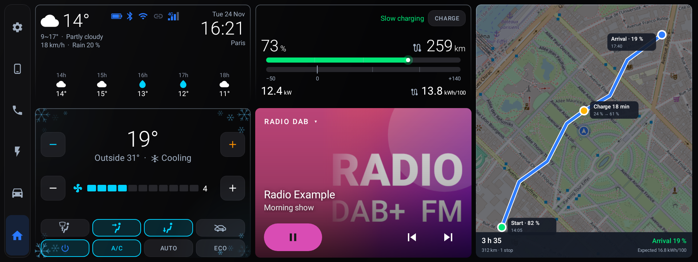 | 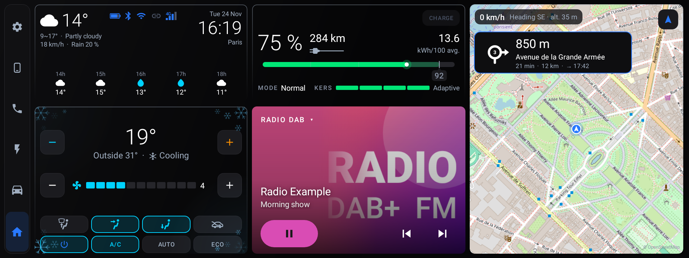 |

</details>

<details>
<summary>Les cartes Consommation, Raccourcis et Web app en détail</summary>

- **Consommation** : une touche passe à la période suivante : depuis la dernière charge, trajet en cours, ou les 12 derniers mois. Le pointillé est la moyenne (énergie sortie de la batterie moins la régénération, sur la distance). *Régén* montre l'énergie récupérée et la part de la distance qu'elle a permis de parcourir.
- **Raccourcis** : applis ou actions Home Assistant (scripts, automatisations, scènes, portail, porte de garage…), de 4 à 32 selon la taille de l'emplacement. Touchez une case vide ou faites un appui long sur une case pour la changer. Un raccourci Home Assistant affiche son état en direct sous son nom. L'adresse et le token Home Assistant sont dans l'appui long sur la carte › *Réglages Home Assistant* : saisissez-les avec le clavier de Dash, ou importez-les depuis un fichier `mg4dash_ha.txt` à la racine d'une clé USB (l'adresse sur une ligne, le token sur une autre).
- **Web app** (désactivée par défaut) : activez-la dans le mode édition et touchez sa ligne pour sa liste d'adresses. Au repos, elle se comporte comme les autres cartes ; touchez-la une fois pour l'utiliser comme dans un navigateur. Dans la voiture, la page est affichée par *MG4Dash Web*, une petite appli embarquée dans MG4Dash (Android refuse les pages web à une appli ayant les droits système). Beaucoup de sites récents ont besoin du [moteur web récent](#mises-à-jour-sauvegardes-et-applis-compagnons).

| Consommation | Raccourcis |
|---|---|
| 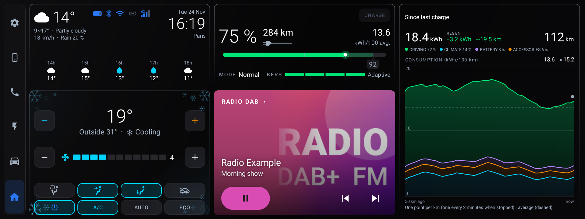 | 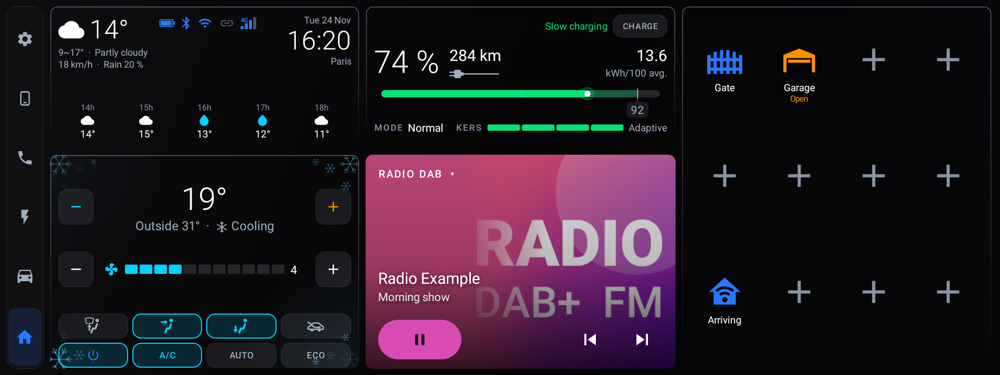 |

</details>

## Organiser l'accueil

**Choisir les cartes de chaque emplacement** : pincez l'accueil à deux doigts, ou Réglages › **Écran** › *Modifier la disposition et les widgets*. Chaque emplacement montre ce qu'il peut contenir :

- un **emplacement moyen** affiche la clim, le média, ou des cartes à tour de rôle ;
- dans un emplacement de **cartes**, touchez une carte pour l'y ajouter ou l'en retirer (une carte n'est qu'à un seul endroit à la fois) ;
- **Par défaut** remet la disposition d'origine ; **Terminé** ferme le mode édition.

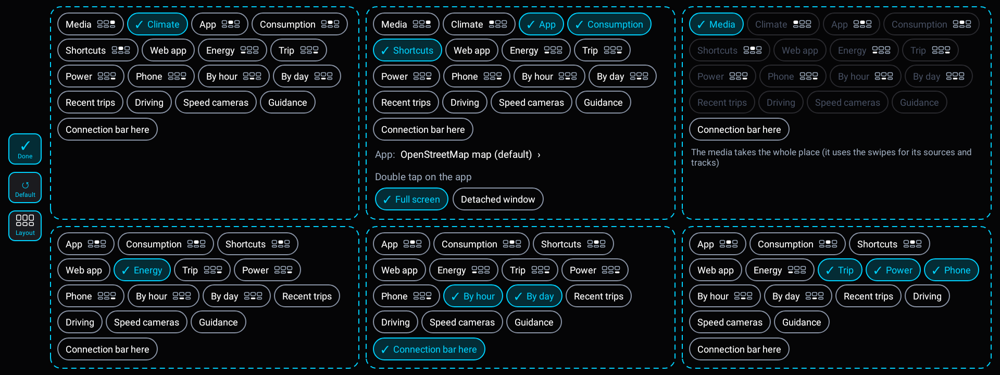

**Cartes proposées** : Réglages › **Écran** › *Cartes proposées…* liste toutes les cartes, sur trois colonnes par ordre alphabétique. Décochez celles que vous n'utilisez jamais : elles quittent l'accueil et le mode édition, et reviennent à leur place si vous les recochez.

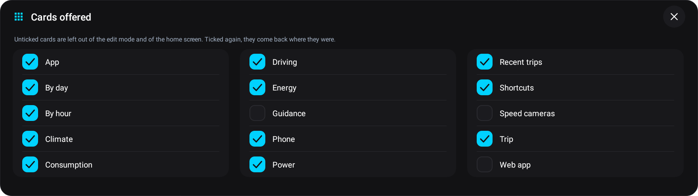

**Styles d'accueil** (Réglages › **Écran** › *Style d'accueil*) :

- **Standard** : huit dispositions : *Complète* (par défaut), *Carte à droite*, *Carte à gauche*, *Carte au centre*, *Grand carré à gauche* ou *à droite*, *Bandeau en haut* ou *en bas*.
- **Grand affichage** : tout est un tiers plus grand, avec un contraste renforcé. Sept dispositions de deux à quatre emplacements (*Quatre* par défaut). La tuile *Grand affichage* du menu de raccourcis l'active et le désactive.
- **Épuré** : moins de boutons et des textes plus grands, sans cartes à choisir.

| Grand affichage, *Quatre* | Standard, *Carte à droite* |
|---|---|
| 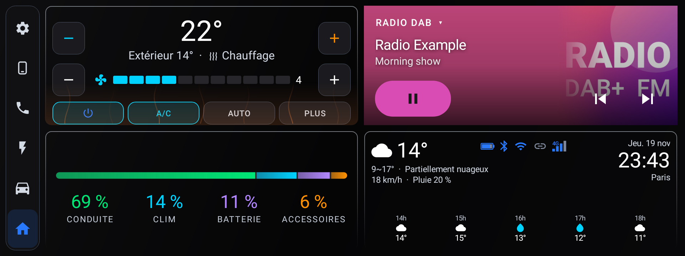 | 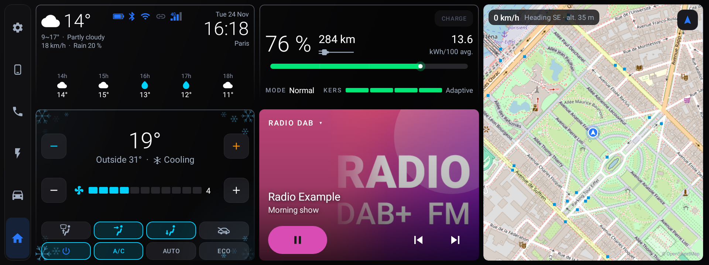 |

La **barre** peut être verticale côté conducteur (par défaut), forcée à gauche ou à droite, ou horizontale en bas avec l'horloge ; *Barre latérale large* la rend deux fois plus large (Réglages › **Écran** › *Barre*).

## Menu de raccourcis

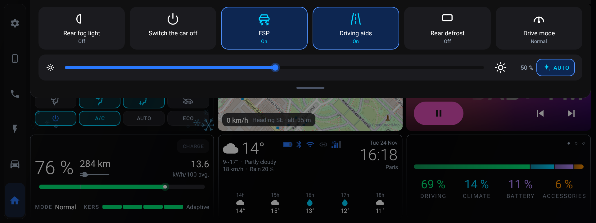

Glissez un doigt vers le bas depuis tout en haut de l'écran. Le panneau suit le doigt, sur tous les écrans de MG4Dash et sur les autres applis, Android Auto compris. Remontez-le ou touchez à côté pour le fermer.

- Chaque tuile envoie une commande et affiche l'état de la voiture : antibrouillard arrière, éteindre la voiture (refusé en roulant), ESP, aides à la conduite, dégivrage arrière, mode de conduite, et à ajouter : régénération, one pedal, clim, préchauffage batterie, volant chauffant, portes, verrou de charge, V2L, écran éteint, couper Android Auto, ADB, profil, grand affichage. Les tuiles que la voiture ne gère pas ne sont pas proposées.
- **Appui long** sur le menu pour choisir ses tuiles.
- **Luminosité de l'écran** sous les tuiles, avec **AUTO** (voir [luminosité](#apparence--thèmes-couleurs-et-luminosité)).
- Réglages › **Écran** › *Menu de raccourcis* (activé par défaut) cache aussi le bouton antibrouillard de MG avec une surcouche, à partir du prochain démarrage de l'autoradio, et rend son coin à la barre.

<details>
<summary>L'ADB depuis le menu</summary>

Un raccourci d'accueil (appui long sur un raccourci › *ADB*) et une tuile du menu activent l'ADB sur le port USB, comme l'appli adbutil de la voiture. Réglages › **Système** › *Activer l'ADB au démarrage* (désactivé par défaut) l'active à chaque démarrage. Il se coupe au démarrage suivant de la voiture.

</details>

## Médias, radio et Android Auto

La carte média suit la source active de la voiture (radio DAB / FM, Bluetooth, USB, Android Auto, CarPlay) et les autres applis qui jouent de la musique sur l'autoradio.

- **Balayez** vers le haut / le bas pour la source suivante, à gauche / à droite pour le morceau suivant / précédent.
- **Touchez le nom de la source** pour le menu des sources : il ne liste que les sources disponibles maintenant.
- **Touchez l'image** pour ouvrir l'appli de la source ; **appui long sur lecture / pause** pour la page Son.
- **Ouvrir Android Auto de partout** : avec un téléphone connecté, glissez un doigt depuis le bord gauche ou droit de l'écran.
- **Couper la connexion du téléphone** : double appui sur le bouton Android Auto de la barre. L'icône passe au rouge et le téléphone reste en Bluetooth pour les appels et la musique ; un nouveau double appui ramène Android Auto.

**Au démarrage** (Réglages › **Média et sons**) : la *Source au démarrage* est *Automatique* par défaut (retour à la dernière source encore disponible), *Comme la voiture*, ou une source fixe. La *Lecture au démarrage* reprend *Comme à l'arrêt de la voiture*, *Toujours en pause* ou *Toujours en lecture*. La séquence de démarrage et le son de démarrage attendent que la voiture soit vraiment utilisée : écran allumé, et READY, ou une lecture que vous lancez vous-même (déverrouiller ou ouvrir une portière ne suffit pas). Ouvrir le coffre d'une voiture verrouillée ne fait rien jouer ([#133](https://github.com/Skittle6938/MG4Dash/issues/133)). *Pause en sortie du mode READY* (désactivée par défaut) met la lecture en pause quand la voiture quitte le mode READY ; elle reprend quand la voiture repasse en READY.

### Paroles synchronisées

Placez la carte facultative **Paroles** depuis le mode édition de l'accueil. Quand un morceau n'est pas en cache, MG4Dash envoie son artiste, son titre et sa durée à LRCLIB pour trouver des paroles synchronisées ou simples. Les paroles téléchargées sont gardées en cache dans l'écran ; la taille du cache et l'option Wi-Fi uniquement sont dans les réglages de la carte (appui long), et les morceaux en cache restent disponibles hors connexion. Sur la radio (FM, AM, DAB), il n'y a pas de paroles. Dans MG4Control, créez un raccourci personnalisé avec **Envoyer un broadcast**, l'action `app.mg4dash.action.TOGGLE_LYRICS_OVERLAY` et MG4Dash comme appli cible pour afficher ou cacher la bulle de paroles flottante depuis un bouton du volant ou une bulle de raccourci.

<details>
<summary>Volant, autres applis et bouton Android Auto</summary>

- **Volant** : gauche / droite changent de morceau sur la source affichée, applis comprises. La voiture donne pourtant ces boutons à sa dernière source à elle (souvent la radio) ; MG4Dash remet la radio sur sa station et revient aussitôt à l'appli.
- **Les autres applis** qui jouent de la musique (MG4Link, SimpMusic…) sont proposées comme sources. Passer sur une appli lui envoie lecture, la quitter la met en pause.
- **Le bouton Android Auto de la barre** (Réglages › **Média et sons** › *Bouton Android Auto de la barre*) ouvre Android Auto d'origine, CarPlay ou une autre appli comme MG4Link.
- Avec **MG4Radio** sur SWI69, le DAB et la FM peuvent être deux sources séparées, et la bande AM peut être ajoutée.
- Un **son au démarrage** à vous (un fichier audio d'une clé USB ou de la mémoire interne, 30 s et 20 Mo au maximum) peut jouer au démarrage de la voiture, avec son propre volume (Réglages › **Média et sons** › *Son au démarrage*).

</details>

## Pages : climatisation, énergie, véhicule, son, téléphone, trajets

### Climatisation

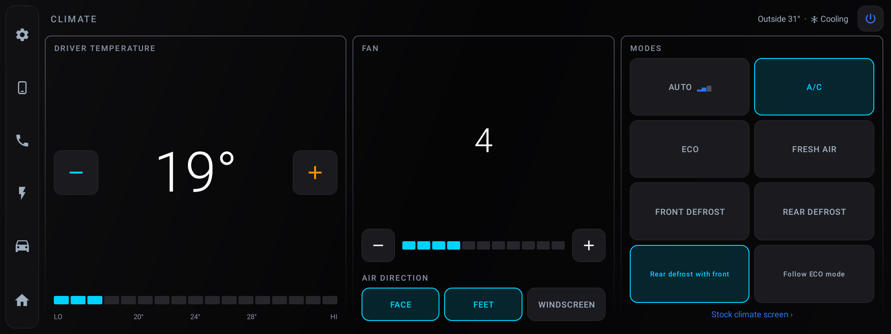

Température, ventilation, diffusion de l'air combinable, AUTO, A/C, ECO, recyclage, dégivrage avant et arrière. Ouvrez-la depuis la zone de température de la carte clim.

### Clim maintenue

Un mode camping, pour quand vous êtes absent ou que vous dormez dans la voiture : appui long sur le bouton marche de la clim. Activez-le d'abord dans les réglages de la carte clim (appui long sur la carte). Il fonctionne **maintenant** (pour une durée fixée ou sans limite) ou **à une heure fixée**, en une ou plusieurs fois.

- Après un compte à rebours, **MG4Dash verrouille lui-même les portes** : sortez et prenez la clé. Ne verrouillez pas avec la télécommande, qui éteint toute la voiture.
- Un grand écran d'état reste lisible depuis l'extérieur.
- Il s'arrête après la dernière période, à la fin de la durée fixée ou sous 20 % de batterie, et s'arrête dès que les portes sont déverrouillées ou que la voiture roule.
- **Ne laissez jamais un enfant ou un animal seul dans la voiture** : la clim peut s'arrêter à tout moment.

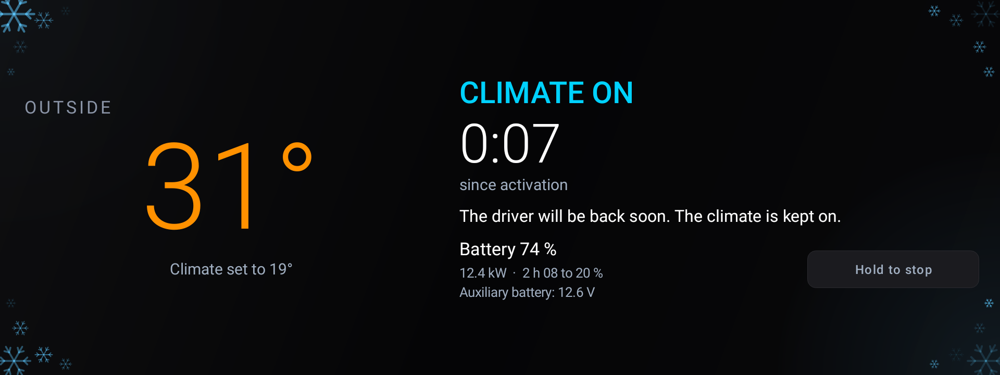

### Énergie

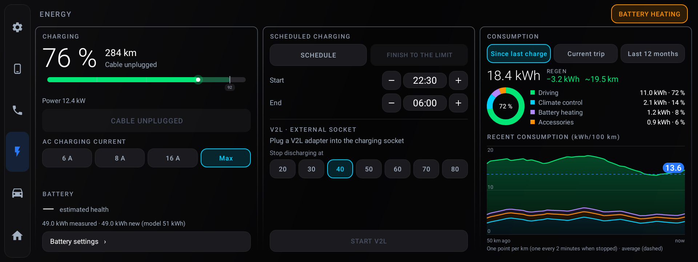

Charge (marche / arrêt, limite de charge là où la voiture l'applique, courant, temps restant, verrou du câble), charge programmée, V2L, chauffage de la batterie, et consommation par période avec la part de la conduite, de la clim, du chauffage de la batterie et des accessoires.

La section **batterie** estime la santé de la batterie : en roulant, MG4Dash mesure l'énergie prise à la batterie par rapport à la baisse du %, et à partir de 15 % de baisse donne une mesure datée de la capacité utile. Sa fenêtre (touchez la section batterie) règle le modèle de batterie et votre propre capacité neuve. C'est une estimation, pas une mesure officielle.

### Véhicule

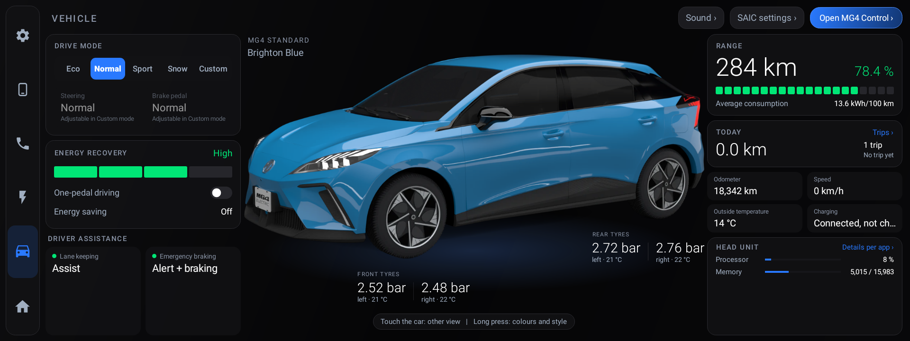

Mode de conduite (Eco, Neige et Custom selon les voitures), régénération (le niveau 6 est la conduite à une pédale), aides à la conduite, pression et température des pneus, état de la voiture, et les applis en cours de l'autoradio (touchez la section autoradio) : processeur et mémoire de chaque appli, rafraîchis toutes les 3 s.

### Son

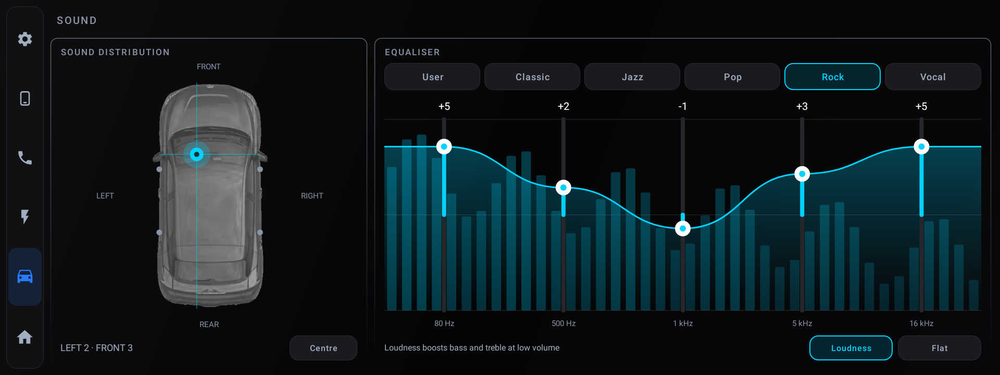

Ouvrez-la depuis la page Véhicule ou par un appui long sur lecture / pause. Faites glisser le point sur la voiture pour la balance et le fader ; égaliseur 5 bandes avec les préréglages de la voiture ou votre propre courbe. Ce sont les réglages de la voiture elle-même.

### Téléphone

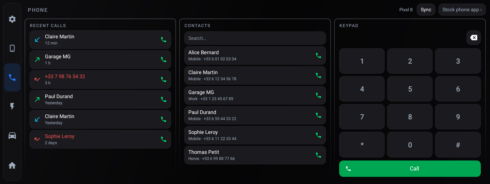

Appels récents, contacts avec recherche et clavier, depuis le téléphone connecté en Bluetooth. L'écran d'appel d'origine est conservé.

### Trajets

Chaque trajet avec sa distance, son énergie et sa consommation. Le bouton *Prix du kWh* donne son coût à chaque trajet. Ouvrez-la depuis la carte Derniers trajets.

## Réglages

Touchez la **roue dentée** de la barre. Les Réglages ont cinq onglets ; le menu des profils (*Profil : Principal ▾*) est à côté, et le dernier onglet utilisé s'ouvre la fois suivante. Toutes les fenêtres ont le même design : un titre, des lignes groupées, des interrupteurs, une croix ronde en haut à droite, et un toucher à côté ou la touche Accueil les ferme.

| Onglet | Ce qu'on y trouve |
|---|---|
| **Écran** | Style et disposition de l'accueil, modifier la disposition et les cartes, *Cartes proposées*, le tuto des gestes, la barre (position, barre large), le menu de raccourcis |
| **Apparence** | Clair, sombre ou automatique, nuit après le coucher du soleil, contour des panneaux, couleurs du fond et des boutons (24 chacune), luminosité |
| **Média et sons** | Source et lecture au démarrage, le bouton Android Auto de la barre, le son au démarrage, les bandes de MG4Radio (avec MG4Radio) |
| **Général** | Unités, pression des pneus, horloge, clavier MG4Dash, données 4G des 30 derniers jours et leur détail |
| **Système** | Remplacer l'accueil SAIC, Mode Entretien, mises à jour, sauvegarde des réglages, diagnostic (test de compatibilité, journal, ADB au démarrage, enregistreur de données énergie) |

| Écran | Apparence |
|---|---|
| 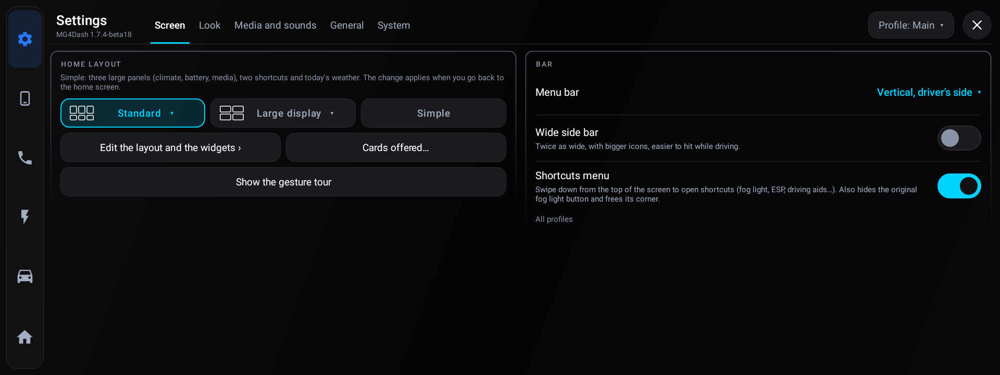 | 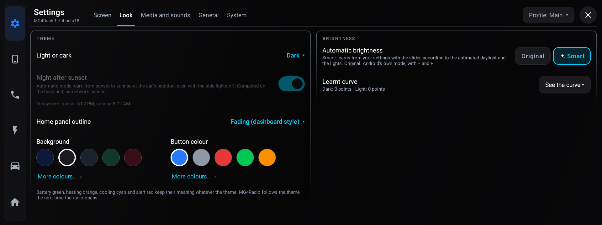 |
| **Média et sons** | **Général** |
| 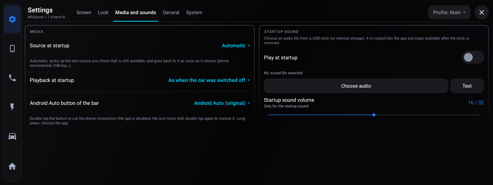 | 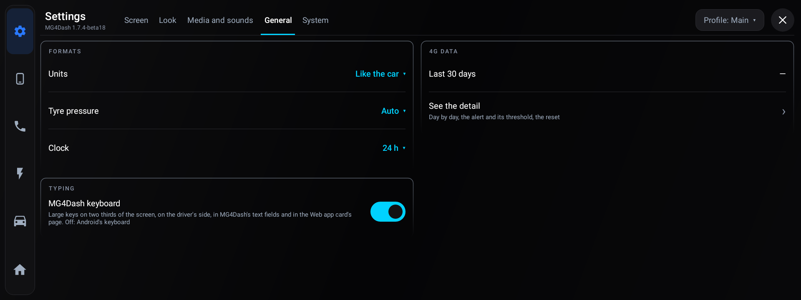 |
| **Système** | |
| 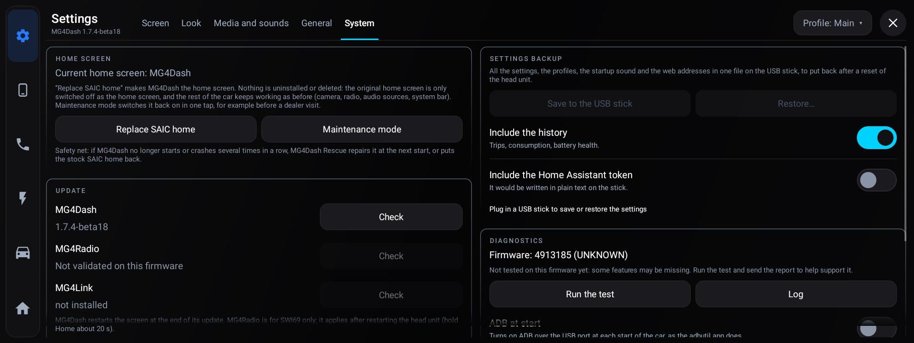 | |

**Les réglages déplacés dans leur carte ou leur page** (appui long sur la carte) :

| Réglage | Où |
|---|---|
| Calibration de la clim, clim intermittente, sièges et volant chauffants, Clim maintenue | Carte Climatisation |
| Puissance en direct dans la carte énergie, tension et courant, V2L | Carte Énergie |
| MG4 XPower, effets à pleine accélération et leur son | Carte Puissance |
| Zoom et couleurs de la carte, passage au widget énergie hors ligne | Carte Application (appui long › roue dentée) |
| Consommation à l'arrêt, effacer une courbe | Carte Consommation |
| Modèle météo, ville de repli | Cartes météo |
| Adresse, token, test et import USB de Home Assistant | Carte Raccourcis |
| Tout l'avertisseur de radars | Carte Avertisseur |
| Prix du kWh | Page Trajets |
| Modèle de batterie, capacité neuve | Page Énergie › batterie |
| Mode de conduite et régénération repris par profil | Fenêtre du profil |

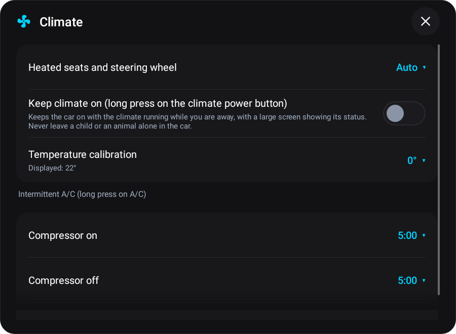

<details>
<summary>Le clavier MG4Dash</summary>

Les champs de texte de MG4Dash utilisent son propre clavier à grandes touches (AZERTY en français, QWERTZ en allemand, QWERTY sinon). Appui long sur une lettre pour ses accents, appui long sur Maj pour la verrouiller, appui long sur Effacer pour vider le champ. La page de la carte Web app l'utilise aussi. Réglages › **Général** › *Clavier MG4Dash* revient au clavier d'Android.

</details>

<details>
<summary>Météo : recherche de ville et modèles</summary>

La météo suit la position de la voiture. Appui long sur une carte météo :

- *Ville de repli* (utilisée quand la position n'est pas connue) : *Position actuelle*, ou *Rechercher une ville…*, saisie avec le clavier de Dash.
- *Modèle météo* : *Automatique (recommandé)* choisit le meilleur modèle pour votre région ; vous pouvez aussi forcer Météo-France, européen (ECMWF), allemand (DWD), britannique (Met Office), américain (NOAA) ou canadien (GEM). N'en forcez un que si les prévisions sont souvent fausses.

Quand une mise à jour échoue (pas de connexion), les dernières prévisions restent jusqu'à 3 heures.

</details>

<details>
<summary>Données 4G</summary>

Réglages › **Général** montre les données 4G de la voiture sur les 30 derniers jours. *Voir le détail* les ouvre par usage et par jour, celles du Wi-Fi aussi, avec un quota mensuel facultatif et une alerte.

</details>

## Apparence : thèmes, couleurs et luminosité

**Thème** (Réglages › **Apparence**) : **Auto (jour / nuit)** (par défaut, suit les feux de la voiture), **Sombre** ou **Clair**. En Auto, *Nuit après le coucher du soleil* (activé par défaut) passe en sombre du coucher au lever du soleil à la position de la voiture, calculé sur l'autoradio. Le changement attend que les feux soient stables et se fait en fondu.

**Couleurs** : 24 fonds et 24 couleurs de boutons, les premières sur l'onglet et *Plus de couleurs…* pour toute la grille. Elles s'appliquent à toutes les pages et à [MG4Radio](https://github.com/Skittle6938/MG4Radio). Le vert batterie, l'orange chauffage, le cyan froid et le rouge alerte gardent leur sens.

**Luminosité** (Réglages › **Apparence** › *Luminosité*) : *Intelligente* par défaut, *D'origine* est le mode automatique d'Android. Le capteur de lumière de la voiture ne donne pas de vraie mesure à Android : le mode intelligent estime donc la lumière extérieure à partir de la hauteur du soleil à la position de la voiture, de la couverture nuageuse des prévisions et des feux. Chaque correction faite avec la barre de luminosité du menu de raccourcis devient un point de sa courbe.

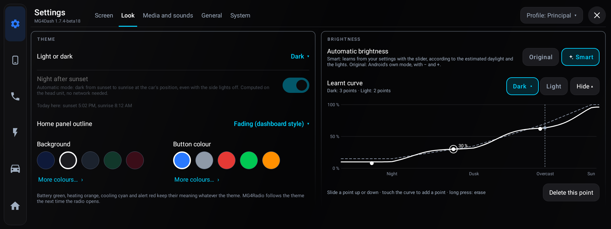

<details>
<summary>La courbe de luminosité en détail</summary>

Par défaut, la courbe donne 15 % la nuit, 35 % au crépuscule, 70 % par temps gris et 100 % en plein soleil. Laissez une correction 4 s et elle devient un point ; la courbe reste douce et croissante. *Voir la courbe ▾* l'affiche : faites glisser un point, touchez la courbe pour en ajouter un, sélectionnez un point puis *Supprimer ce point*. **Sombre | Clair** choisit la courbe affichée : chaque apparence et chaque profil a la sienne. Un appui long sur une partie vide du graphique efface cette courbe ou les deux.

</details>

## Profils

Jusqu'à 5 profils, pour plusieurs conducteurs ou plusieurs façons de conduire, depuis le menu **Profil : Principal ▾** en haut des Réglages ou la tuile *Profil* du menu de raccourcis. Chaque profil garde son propre accueil (style, disposition et cartes, raccourcis), son apparence, ses courbes de luminosité, sa source audio au démarrage, sa carte et sa web app, son Home Assistant, sa ville météo, ses unités et son horloge, et ses alertes radars. Les mises à jour, l'ADB, le Mode Entretien, les données énergie et les trajets restent partagés.

- *Nouveau profil* : un nom, à partir du profil actuel ou des réglages par défaut.
- *Téléphone associé (facultatif)* : à la première connexion de ce téléphone après un démarrage, MG4Dash passe tout seul sur son profil.
- *Reprendre le mode de conduite et la régénération de ce profil* (dans la fenêtre du profil, pour chaque profil) : en quittant le profil, MG4Dash note le mode de conduite et la régénération ; en y revenant, il les remet.

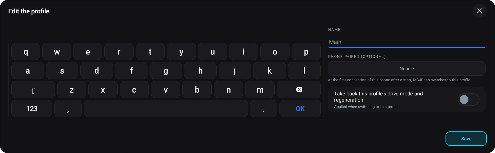

## Avertisseur de radars

Placez la carte **Avertisseur** sur l'accueil (pincez l'accueil). Elle affiche la limitation de vitesse de la route et vous avertit dans les zones de radars, à partir des seules données [OpenStreetMap](https://www.openstreetmap.org/copyright). L'avertisseur fonctionne tant que la carte est dans un emplacement, même quand une autre carte est affichée, et ses alertes s'affichent par-dessus Android Auto.

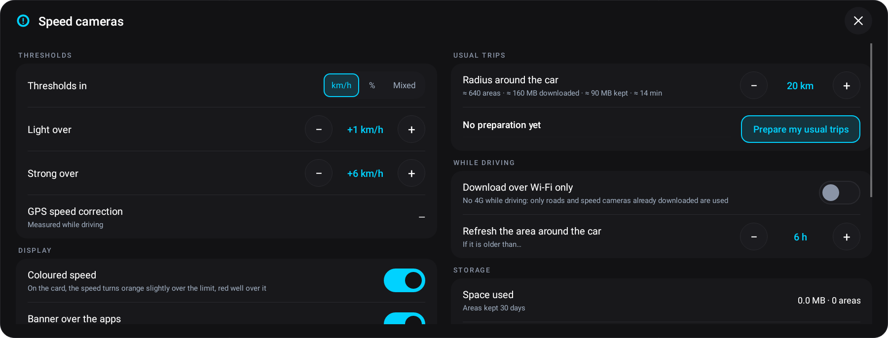

**Appui long sur la carte** pour tous ses réglages, dans une seule fenêtre :

- **Seuils** : une alerte légère (orange) et une alerte forte (rouge) au-dessus de la limite, en km/h, en % ou mixte, réglées avec − et + ou saisies à la valeur près ; une correction de la vitesse GPS.
- **Affichage** : *Vitesse en couleur* sur la carte, et le *Bandeau par-dessus les applis*, affiché seulement quand on dépasse la vitesse dans une zone radar (alerte forte).
- **Sons** : un par alerte, parmi 9 sons ou aucun ; touchez la ligne d'un son pour son volume et sa répétition.
- **Trajets habituels** : *Préparer mes trajets habituels* télécharge à l'avance les zones dans un rayon de 5 à 50 km autour de la voiture, pour les avoir hors ligne.
- **En roulant** : téléchargement en Wi-Fi uniquement, et fréquence de rafraîchissement d'une zone.
- **Stockage** : la place occupée, et *Effacer*.

## Mises à jour, sauvegardes et applis compagnons

**Mises à jour** (Réglages › **Système**) : une ligne pour MG4Dash, MG4Radio et MG4Link, avec la version installée et la dernière. *Installer* affiche les notes de version et installe. *Vérification automatique* (activée par défaut) cherche une fois par semaine, ou chaque jour avec *Inclure les versions bêta*. Une nouvelle version officielle est aussi proposée sur l'accueil. Un téléchargement coupé par le réseau reprend là où il s'est arrêté. Depuis la 1.7.4, l'appli publiée est réduite avec R8 : environ 8,6 Mo au lieu de 14,9 Mo.

**Sauvegarde des réglages** (Réglages › **Système**) : *Sauvegarder sur la clé USB* écrit tous les réglages, les profils, le son au démarrage et les adresses web dans `mg4dash_settings_AAAAMMJJ_HHMM.json` à la racine de la clé. *Inclure l'historique* ajoute les trajets, la consommation et la santé de la batterie ; *Inclure le token Home Assistant* ajoute le token, en clair. *Restaurer…* liste les sauvegardes de la clé ; MG4Dash remplace ses réglages et redémarre.

<details>
<summary>MG4Radio, le moteur web récent et la désinstallation</summary>

- **[MG4Radio](https://github.com/Skittle6938/MG4Radio)** est la radio redessinée dans le style de MG4Dash. Elle s'installe depuis la même page, **sur SWI69 uniquement**, où elle remplace la radio d'origine. Redémarrez ensuite l'autoradio en maintenant Accueil environ 20 s.
- **Moteur web récent** : une troisième ligne installe Chromium 138 à la place de la WebView de la voiture (Chromium 66), pour que les sites d'aujourd'hui s'ouvrent dans la carte Web app (ABRP, Waze…). C'est un téléchargement de 243 Mo depuis [MG4Dash-WebView](https://github.com/Skittle6938/MG4Dash-WebView), de préférence en Wi-Fi. *Remettre l'origine* remet le moteur de la voiture ; les données des sites sont perdues dans les deux sens.
- **Désinstaller** : *Désinstaller MG4Dash, MG4Radio ou MG4Link…* sur la même page, puis *Maintenir pour désinstaller*. Pour MG4Dash, il remet d'abord l'accueil SAIC, puis supprime MG4Dash, son appli de secours et tous ses réglages ; MG4Radio et MG4Link restent installés. Pour réinstaller MG4Dash ensuite, il faut refaire une première installation.

</details>

## Mode Entretien et retour à l'accueil SAIC


Réglages › **Système** › **Mode Entretien** remet l'accueil SAIC en un geste, exactement comme avant : pour un passage chez le concessionnaire ou un problème.

- **Revenir à MG4Dash** : glissez **trois doigts** vers le bas depuis le haut de l'écran, sur l'accueil SAIC ou n'importe quelle appli, et touchez **Remettre MG4Dash** sur le petit bandeau. Choisir MG4Dash comme appli d'accueil dans les paramètres d'Android marche aussi.
- En Mode Entretien, rien de MG4Dash ne réagit : un raccourci ou une autre appli qui ouvre un de ses écrans le voit se refermer aussitôt.
- **Ouvert depuis la liste d'applis d'un autre launcher**, MG4Dash fonctionne comme une appli normale et l'accueil SAIC reste l'écran d'accueil.
- Si MG4Dash plante 3 fois en 3 minutes, l'accueil SAIC revient tout seul.

## Gestes

Les plus utiles ; le [tuto des gestes](#premiers-pas) les montre à l'écran.

| Geste | Où | Effet |
|---|---|---|
| Appui long | une carte | ses réglages |
| Pincement à deux doigts | l'accueil | choisir les cartes |
| Un doigt vers le bas depuis le haut | partout | menu de raccourcis |
| Un doigt depuis le bord gauche ou droit | partout | Android Auto, quand un téléphone est connecté |
| Double appui | bouton Android Auto | couper / rétablir la connexion du téléphone |
| Appui long | bouton Android Auto | Android Auto, CarPlay ou une autre appli |
| Appui long | roue dentée | les réglages de la voiture |
| Balayage | un emplacement de cartes | carte suivante |
| Balayage haut / bas, gauche / droite | carte média | source suivante, morceau suivant / précédent |
| Double appui | carte Application, Web app | plein écran, ou fenêtre détachée |

<details>
<summary>Tous les gestes</summary>

- Appui long sur « Accueil » dans le dock du bas : applis installées. Appui long sur l'horloge : réglages de l'horloge ou du Wi-Fi.
- Barre verticale : double appui sur Énergie éteint l'écran, appui long sur Énergie éteint la voiture (jamais en roulant) ; double appui sur Véhicule verrouille / déverrouille les portes, appui long sur Véhicule coupe / remet l'ESC.
- Touchez la zone de température : page Climatisation. Appui long sur ventilation moins : vitesse la plus basse. Appui long sur A/C : clim intermittente.
- Appui long sur lecture / pause : page Son. Touchez le nom de la source de la carte média : menu des sources.
- Touchez un segment de la jauge de régénération : niveau de régénération ; appui long : conduite à une pédale.
- Balayez la carte météo : par heure ↔ par jour.
- Appui long sur un raccourci : le modifier. Appui long sur un favori du téléphone : le changer.
- Appui long sur les icônes de connexion : choisir lesquelles s'affichent (USB-A et USB-C sont masquées par défaut).
- Bouton * du volant : caméra 360 marche / arrêt.
- Deux doigts vers le bas depuis le haut sur une autre appli : retour à l'accueil de MG4Dash. Trois doigts sur la projection de MG4Link terminent sa session.
- Carte Application ou Web app : un toucher la réveille (contour allumé) ; appui long : *Retour*, *Déplacer / redimensionner* quand elle est détachée, et ce qu'elle affiche.
- Bouton de recentrage de la carte : suivre à nouveau la voiture ; appuyez encore pour nord en haut ou cap en haut.

</details>

## Dépannage

<details>
<summary>« Phone is starting… » après une mise à jour</summary>

C'est l'écran d'attente d'Android lui-même, affiché pendant que MG4Dash est arrêté et optimisé après une mise à jour (environ 50 secondes). À partir de MG4Dash Rescue 9, un écran *Mise à jour de MG4Dash…* le remplace. MG4Dash revient tout seul.

</details>

<details>
<summary>MG4Dash ne démarre plus après une installation</summary>

MG4Dash Rescue le répare tout seul : il recompile et relance MG4Dash, et remet l'accueil SAIC si cela ne suffit pas. Pour supprimer MG4Dash : Réglages › **Système** › *Désinstaller MG4Dash, MG4Radio ou MG4Link…*, puis *Maintenir pour désinstaller*.

</details>

<details>
<summary>L'accueil SAIC ou un choix de launcher s'affiche à la place de MG4Dash</summary>

Après une installation, Android peut demander quel accueil utiliser : choisissez MG4Dash puis *Toujours*. Après une boucle de plantages, le garde-fou de MG4Dash remet l'accueil SAIC ; ouvrez MG4Dash avec trois doigts vers le bas › *Remettre MG4Dash*.

</details>

<details>
<summary>Une fonction manque sur ma voiture</summary>

Le firmware ne l'expose probablement pas (voir [Avant d'installer](#avant-dinstaller)). Lancez le test de compatibilité (Réglages › **Système** › *Diagnostic*) et ouvrez l'issue qu'il prépare.

</details>

## Créer et proposer une carte d'accueil (widget)

Une **carte** (ou widget) est ce qui remplit un emplacement de l'accueil. Toutes les cartes suivent un même contrat : l'accueil les place, leur donne leur taille, les démarre et les arrête, et ouvre leurs réglages sur un appui long, de la même façon pour toutes. Vous n'écrivez que la carte.

### 1. En parler d'abord

[Ouvrez une issue](https://github.com/Skittle6938/MG4Dash/issues/new?template=feature.yml) avant de coder : ce que la carte affiche, en quoi elle aide en conduisant, ce qu'elle fait dans chaque taille et de quelles données elle a besoin (voiture, réseau, autre appli). On s'y met d'accord sur le comportement et les choix d'implémentation, pour que la pull request aille vite.

### 2. Les pièces à utiliser

| Pièce | Fichier | Rôle |
|---|---|---|
| `HomeCard` | `app/src/main/java/app/mg4dash/cards/HomeCard.kt` | Le contrat : `card`, `view`, `place()`, `shown()`, `options()` |
| `HomeSlots.Card` | `app/src/main/java/app/mg4dash/ui/HomeSlots.kt` | L'identité de la carte : id, nom, icône, tailles |
| `HomeCards.factories` | `app/src/main/java/app/mg4dash/cards/HomeCards.kt` | Une ligne qui crée la carte |
| `CardPlace` | `cards/HomeCard.kt` | La forme de son emplacement : `small`, `medium`, `tall`, `wide`, `big` |
| `CardScope` | `cards/CardScope.kt` | Ce que la carte suit quand elle est affichée, annulé quand elle est cachée |
| `CardPrefs` | `cards/CardPrefs.kt` | Ses réglages, clés `card_<id>_<nom>`, par profil et dans la sauvegarde |
| `CardKit` | `cards/CardKit.kt` | Marges, titre, tailles de texte, lignes, séparateurs, boutons, « Pas encore de données », aux couleurs du thème |
| `OptionsPopup` | `ui/OptionsPopup.kt` | La fenêtre de réglages de l'appui long : `toggle`, `check`, `choice`, `slider`, `stepper`, `action`, `note` |
| `Windows`, `Rows` | `ui/Windows.kt`, `ui/Rows.kt` | Toute autre fenêtre (`show`, `confirm`, `pick`) et ses lignes |
| `TemplateCard` | `app/src/testEmulator/java/app/mg4dash/cards/TemplateCard.kt` | Une carte complète à copier, rendue par les tests |

### 3. Pas à pas, avec la carte Guidage

La carte **Guidage** (`ui/NavCard.kt`) est un bon exemple réel : elle affiche le guidage pas à pas, s'adapte à toutes les tailles et ne suit ses données que lorsqu'elle est affichée.

**a. Copiez le gabarit.** Copiez `TemplateCard.kt` dans `app/src/main/java/app/mg4dash/cards/VotreCarte.kt`. Il contient toutes les parties, dans l'ordre.

**b. Déclarez-la** avec une entrée dans `HomeSlots.Card` :

```kotlin
NAV("nav", R.string.wc_nav, R.drawable.ic_map, big = true, manual = true),
```

`big = true` si elle peut remplir un emplacement de deux colonnes ; `manual = true` pour qu'une nouvelle carte n'apparaisse que là où le conducteur la place.

**c. Enregistrez-la** avec une ligne dans `HomeCards.factories` :

```kotlin
Card.NAV to ::NavCard,
```

C'est tout le câblage : rien à changer dans `MainActivity` ni dans le mode édition.

**d. Implémentez le contrat.**

```kotlin
class NavCard(context: Context) : FrameLayout(context), HomeCard {
    override val card = HomeSlots.Card.NAV
    override val view: View get() = this

    // Size: read the shape of the place, never the screen
    override fun place(p: CardPlace) { form = formFor(p.size) }

    // Life: follow the data only while shown; everything stops when hidden
    private val follow = CardScope()
    override fun shown(on: Boolean) = follow.set(on) {
        launch { NavRepo.nav.collect { n -> show(n) } }
    }
}
```

- `place(p)` est appelé avant le premier affichage de la carte et quand elle change de place. Utilisez `p.small`, `p.medium`, `p.tall`, `p.wide` ; en Grand affichage (`p.big`), le texte est déjà plus grand tout seul.
- `shown(true)` : affichez tout de suite les données, puis suivez-les. `shown(false)` : arrêtez les collecteurs, minuteries et accès réseau. Il peut être appelé deux fois de suite.

**e. Réglages.** Rangez-les avec `CardPrefs` et affichez-les dans `options()`, comme le fait le gabarit :

```kotlin
private val prefs = CardPrefs(context, card)
private var showRange: Boolean
    get() = prefs.bool("show_range", true)
    set(v) = prefs.setBool("show_range", v)

override fun options(popup: OptionsPopup): OptionsPopup =
    popup.toggle(context.getString(R.string.vh_range), null, { showRange }) { showRange = it; render() }
```

> [!WARNING]
> `options()` est aussi appelé une fois à la construction de l'accueil, seulement pour savoir si la carte a des réglages. Cette fenêtre n'est jamais affichée : **ne lancez rien dans `options()`**. Ce qui vit dans la fenêtre (une boucle de rafraîchissement) démarre quand sa vue est attachée et s'arrête quand elle est détachée. Renvoyez `null` si la carte n'a pas de réglages : elle ne réagit alors pas à l'appui long.

**f. Textes.** Tout texte vu par le conducteur va dans `i18n/strings.psv` (clé, puis anglais, français, allemand, espagnol, italien, néerlandais, turc, tchèque), puis :

```powershell
python i18n/gen.py
```

**g. Essayez-la dans l'appli.** Compilez la version émulateur, ou installez dans la voiture, puis pincez l'accueil et touchez votre carte dans un emplacement. Si elle n'apparaît pas dans le mode édition, vérifiez qu'elle est cochée dans Réglages › **Écran** › *Cartes proposées*.

### 4. Réutiliser, pour un aspect et un comportement cohérents

- **Couleurs** : uniquement celles du thème, via `CardKit` ou `Themes.color(context, R.color.…)` : `text_value` pour les valeurs, `text_sub` pour les libellés, `text_title` pour le titre, `panel_border` pour les séparateurs, `accent_action` pour l'accent. Jamais de couleur fixe : les 24 fonds et accents, clairs et sombres, fonctionnent alors tout seuls.
- **Briques** : `CardKit.pad`, `CardKit.title`, `CardKit.text` (17, 44, 22 et 18 sp), `CardKit.row`, `CardKit.divider`, `CardKit.empty`.
- **Fenêtres** : `OptionsPopup` pour les réglages de la carte et `Windows` pour le reste, avec `Windows.confirm` pour une question. Elles apportent le titre, la croix ronde et les lignes ; pas de bouton *Fermer* ni *OK*.
- **Toucher** : rendez toute la carte cliquable (`isClickable = true`) pour qu'un balayage dessus change toujours de carte. Une touche peut ouvrir la page liée ; un appui long ouvre les réglages.
- **Données** : les données voiture depuis `CarBridge.state`, les médias depuis `MediaHub`. N'utilisez les données mobiles que lorsque la carte est affichée, et avec modération.
- **Sécurité** : rien à lire longuement ni à saisir en roulant, pas d'animation qui attire l'œil.

### 5. Les tests à ajouter

Couvrez ces états : **pas encore de données**, chargement, avec données, une erreur (réseau ou valeur voiture manquante), **chaque taille** acceptée, **affichée et cachée** (rien ne tourne quand elle est cachée), et sa fenêtre de réglages.

| Test | Ce qu'il vérifie |
|---|---|
| Un test unitaire de la logique de la carte (Robolectric, comme `HomeCardsTest`) | mise en forme, calculs, les états ci-dessus, `shown(false)` arrête tout |
| `CardGalleryShots` | rend chaque carte enregistrée dans chaque taille acceptée, en sombre et en clair, dans `app/build/screenshots/cards/` : rien à ajouter, il prend votre carte dans `HomeCards.factories` |
| `WindowsFitTest` | la fenêtre de réglages de chaque carte tient dans l'écran 1920 × 720, en normal et en Grand affichage |
| `CardOptionsTest`, `HomeCardsTest` | l'appui long ouvre la fenêtre ; la carte est bien celle listée ; ses clés de réglages suivent le profil |

Commandes, depuis la racine du dépôt :

```powershell
.\gradlew.bat testEmulatorDebugUnitTest
.\gradlew.bat testEmulatorDebugUnitTest -Pscreenshots --tests app.mg4dash.cards.CardGalleryShots
.\gradlew.bat testEmulatorDebugUnitTest --tests app.mg4dash.WindowsFitTest
python i18n/gen.py --check
```

La première lance tous les tests unitaires (sans captures) ; la deuxième écrit les images de votre carte dans `app/build/screenshots/cards/` ; la troisième vérifie sa fenêtre de réglages ; la dernière vérifie les traductions.

| La carte gabarit, dans un emplacement moyen, sombre | et clair |
|---|---|
| 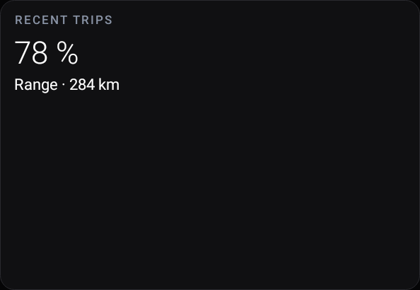 | 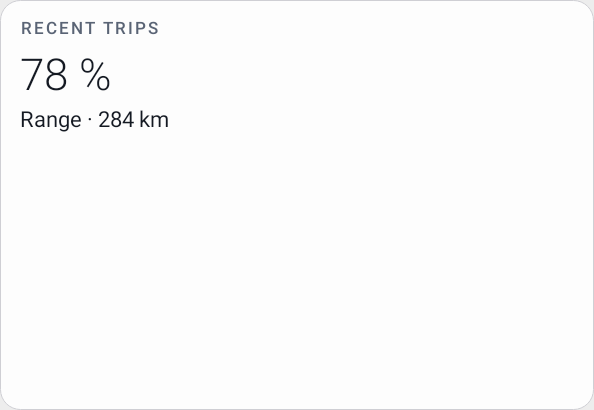 |

### 6. La proposer

Ouvrez une pull request, une carte par PR, et indiquez-y :

- ce que la carte apporte et pour qui ;
- comment l'essayer (où la placer, de quelles données elle a besoin) ;
- quels tests vous avez lancés et leur résultat ;
- une capture si elle aide, depuis `app/build/screenshots/cards/` (sombre et clair).

La CI la compile, lance les tests et le lint, et vérifie les traductions. Les autres règles (clés de réglages, commentaires du code) sont dans [CONTRIBUTING.md](CONTRIBUTING.md) (en anglais).

## Compiler MG4Dash

```powershell
.\sign_platform.ps1                       # signed car build → dist\MG4Dash-<version>.apk
.\gradlew.bat testEmulatorDebugUnitTest   # unit tests on the emulator flavour
.\gradlew.bat testEmulatorDebugUnitTest -Pscreenshots   # screenshots only → app\build\screenshots\
python i18n/gen.py                        # regenerate the translations after editing i18n\strings.psv
```

La version voiture a besoin de la clé plateforme AOSP, qui n'est pas dans le dépôt (les applis de la voiture utilisent la même clé de test publique) :

```powershell
$u = "https://android.googlesource.com/platform/build/+/refs/tags/android-9.0.0_r61/target/product/security/platform.pk8?format=TEXT"
[IO.File]::WriteAllBytes("keys\platform.pk8", [Convert]::FromBase64String((Invoke-WebRequest $u -UseBasicParsing).Content))
```

Les versions publiées sont réduites et optimisées avec R8, en gardant tous les noms de classes et de membres (`app/proguard-rules.pro`) : tout ce qui est appelé par son nom continue de fonctionner.

<details>
<summary>Organisation du projet</summary>

- `app/src/main/java/app/mg4dash/` : l'appli (Kotlin)
  - `cards/` : le contrat des cartes, leur liste et les briques
  - `car/` : l'accès à la voiture (`CarBridge`, `CarProps`, `LegacyCar` pour les anciens firmwares, `ReadyState`)
  - `energy/` : énergie mesurée chaque seconde, courbes de consommation, santé de la batterie
  - `media/MediaHub.kt` : lecteur actif et sources audio, séquence de démarrage, volant pour les applis
  - `radar/` : l'avertisseur de radars (données OpenStreetMap via Overpass)
  - `settings/` : la page Réglages, les profils, la fenêtre Home Assistant, le rapport de compatibilité
  - `ui/` : les éléments de l'accueil, les fenêtres (`Windows`, `Rows`, `OptionsPopup`), les thèmes
  - `system/` : détection du firmware, mises à jour, lien avec Rescue, sauvegarde, Mode Entretien
- `app/src/car/` : manifeste voiture (`sharedUserId=android.uid.system`) et les `rescue.apk`, `web.apk` embarqués
- `app/src/emulator/` : version sans l'uid système, avec des données simulées
- `rescue/` : MG4Dash Rescue, le filet de sécurité
- `web/` : MG4Dash Web, qui affiche la page de la carte Web app dans la voiture
- `i18n/` : les traductions (`strings.psv`) et leur générateur
- `keys/` : le certificat de test de la plateforme AOSP

`rescue/` et `web/` se compilent à part (`.\gradlew.bat :rescue:assembleRelease`, `.\gradlew.bat :web:assembleRelease`), sont signés avec la clé plateforme, et leur APK est commité dans `app/src/car/assets/`. Augmentez la version dans `system/Rescue.kt` ou `system/WebViewer.kt` avec celle du module, pour que MG4Dash installe la nouvelle.

</details>

<details>
<summary>GitHub Actions</summary>

- **PR check** : tests unitaires, versions émulateur et voiture, lint Android, traductions et progression de version. Son résumé liste les résultats des tests, les remarques du lint et la taille des APK.
- **R8 smoke test** : ouvre chaque page de la version réduite dans un émulateur Android 9 ; le moindre plantage le fait échouer.
- **UI previews** : rend des écrans représentatifs en sombre, en clair et en grand affichage, plus l'animation de démarrage.
- **Publish beta** : lancé à la main sur `main` avec un numéro de version et des notes. Il teste, lance le test R8, garde le fichier de correspondance R8 avec l'exécution, signe et publie une préversion. *dry_run* compile et vérifie sans publier.

</details>

## Remerciements, soutien et licence

- [MG4Control](https://github.com/SliDeeN/MG4Control) (SliDeeN) : le chemin de l'API voiture A9.
- [MG4-Custom-Launcher](https://github.com/adammcdonagh/MG4-Custom-Launcher) (adammcdonagh) : les pochettes Bluetooth, les clés de test AOSP et le SDK du launcher d'origine sur SWI68.
- [MG4_Simple_Launcher](https://github.com/Tommasov/MG4_Simple_Launcher) (Tommasov) : notes sur le service d'adaptation véhicule des autres firmwares.
- Cartes et données radars © contributeurs [OpenStreetMap](https://www.openstreetmap.org/copyright) ([ODbL](https://opendatacommons.org/licenses/odbl/)), via osmdroid et l'[API Overpass](https://wiki.openstreetmap.org/wiki/Overpass_API). Météo par [Open-Meteo](https://open-meteo.com/).

**Soutien** : MG4Dash est gratuit et le restera. S'il vous est utile, vous pouvez laisser quelques euros sur [Ko-fi](https://ko-fi.com/skittle6938). Entièrement facultatif, merci !

**Licence** : logiciel libre sous [GNU General Public License v3](COPYING) ou ultérieure, pour toutes les versions publiées. Une partie de la détection du firmware et du code clim des anciens firmwares est adaptée de [MG4Control](https://github.com/SliDeeN/MG4Control) (GPL v3 ; code plus ancien sous licence MIT, notice dans [licenses/MG4Control-MIT.txt](licenses/MG4Control-MIT.txt)). Projet personnel, sans lien avec SAIC / MG. Utilisation à vos risques.

<details>
<summary>Annexe : capacités de batterie de la MG4 utilisées par défaut</summary>

L'énergie utile la plus probable d'une batterie neuve, mesurée de 100 % jusqu'à l'arrêt de la voiture :

- **51 kWh LFP : environ 50 kWh** ; de 100 % à 0 % affiché : environ 49 kWh.
- **64 kWh NMC : environ 62,5 kWh** ; de 100 % à 0 % affiché : environ 61 kWh.
- **77 kWh NMC : environ 74,5 kWh** ; de 100 % à 0 % affiché : environ 72,5 kWh.

Pour l'autonomie, fiez-vous aux valeurs « 0 % affiché » : ce sont celles que MG4Dash utilise par défaut. Vous pouvez régler les vôtres sur la page Énergie › batterie.

</details>
