<div align="center">


# MG4Dash

**Simply your Dash**

**English** · [Français](README.fr.md)

</div>

MG4Dash replaces the home screen of the **MG4** with a full-screen dashboard made for its 1920 × 720 screen: climate, battery and range, a map or the app of your choice, weather and media on one screen, plus pages for climate, energy, vehicle, sound and phone. Every card can be moved or swapped, and the whole look follows the car's lights in dark, light or automatic mode.

It runs on every MG4 head unit firmware (SWI69, SWI131/132/173, SWI68, SWI133, SWI165), in English, French, German, Spanish, Italian, Dutch, Turkish and Czech, with km or miles. It is free software, made by an MG4 owner, not by SAIC / MG.

> [!NOTE]
> Latest stable version: **1.7.3** ([releases](https://github.com/Skittle6938/MG4Dash/releases)). This page describes the current version on `main`, published as the 1.7.4 betas. Some features below are not in 1.7.3 yet; turn on *Include beta versions* in the app to get them ([Updates](#updates-backups-and-companion-apps)).

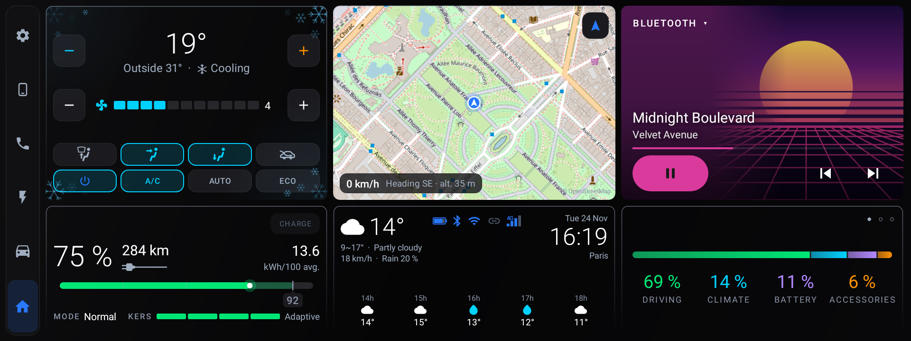

## Contents

1. [Before you install](#before-you-install)
2. [Install MG4Dash](#install-mg4dash)
3. [First steps](#first-steps)
4. [The home screen](#the-home-screen)
5. [Cards: what each one shows](#cards-what-each-one-shows)
6. [Arrange the home screen](#arrange-the-home-screen)
7. [Shortcuts menu](#shortcuts-menu)
8. [Media, radio and Android Auto](#media-radio-and-android-auto)
9. [Pages: climate, energy, vehicle, sound, phone, trips](#pages-climate-energy-vehicle-sound-phone-trips)
10. [Settings](#settings)
11. [Look: themes, colours and brightness](#look-themes-colours-and-brightness)
12. [Profiles](#profiles)
13. [Speed camera alerter](#speed-camera-alerter)
14. [Updates, backups and companion apps](#updates-backups-and-companion-apps)
15. [Maintenance mode and going back to the SAIC home](#maintenance-mode-and-going-back-to-the-saic-home)
16. [Gestures](#gestures)
17. [Troubleshooting](#troubleshooting)
18. [Build and propose a home card (widget)](#build-and-propose-a-home-card-widget)
19. [Build MG4Dash from source](#build-mg4dash-from-source)
20. [Credits, support and licence](#credits-support-and-licence)

## Before you install

| You need | Why |
|---|---|
| An MG4 with the 1920 × 720 head unit | The layout is made for that screen. |
| A data connection in the car (4G or Wi-Fi) | Only for the map, weather, updates and the speed camera data. Everything about the car works offline. |

**Firmware support**: MG4Dash reads the firmware at startup (`ro.build.mt2712.version`) and talks to the car the way that firmware allows. A feature the firmware does not expose is hidden instead of failing.

| Firmware | Status | Notes |
|---|---|---|
| SWI69 | Tested daily by the author | Everything works, including [MG4Radio](https://github.com/Skittle6938/MG4Radio). |
| SWI131, SWI132, SWI173 | Beta, same car access as SWI69 | SWI173 reported in [#33](https://github.com/Skittle6938/MG4Dash/issues/33) and [#35](https://github.com/Skittle6938/MG4Dash/issues/35). |
| SWI68 | Beta, tested by users ([#19](https://github.com/Skittle6938/MG4Dash/issues/19)) | Climate, charging, V2L, radio and driving aids through the stock launcher's SDK. No MG4Radio. |
| SWI133 | Beta ([#13](https://github.com/Skittle6938/MG4Dash/issues/13)) | Like SWI68; battery and range read from the car properties. No MG4Radio. |
| SWI165 | Beta, tested by users ([#28](https://github.com/Skittle6938/MG4Dash/issues/28), [#37](https://github.com/Skittle6938/MG4Dash/issues/37)) | Like SWI68. No MG4Radio. |

<details>
<summary>What differs between firmwares, and how to help support yours</summary>

- **Charge limit**: shown only where the car applies it itself. MG4Dash cannot stop a charge for the car: it is shut down when the car is locked.
- **Connection bars** (mobile network) need a readable T-box, so they are missing on older firmwares.
- **Old firmwares** (SWI68, SWI133, SWI165): the stock launcher opens its own climate screen; MG4Dash can come back in front of it (climate card options).
- **MG4Radio** only works on SWI69, where it replaces the stock radio.
- **Recent web engine** (for the web app card) needs Android 9, 64-bit, with the WebView signed with the AOSP test key.

All MG4 firmwares share the screen and the AOSP platform key, so the same APK installs on every one of them.

To help support your firmware, open Settings › **System** › *Diagnostics* › *Run the test*, then scan the QR code with your phone. It opens a pre-filled [compatibility issue](https://github.com/Skittle6938/MG4Dash/issues/new?template=compatibility.md) with a short report: versions, which car services answer and a few readings. It contains no position, VIN or account, and nothing is sent automatically.

</details>

## Install MG4Dash

1. **Download** the latest `MG4Dash-<version>.apk` from the [releases](https://github.com/Skittle6938/MG4Dash/releases) and install it on the head unit.
2. **Make it the home screen**: in MG4Dash, tap the **gear** on the bar, open the **System** tab and tap **Replace SAIC home**. MG4Dash now opens at startup and with the car's Home button.
3. **Updates** then come from the app itself: Settings › **System** › *Install* ([Updates](#updates-backups-and-companion-apps)).

**Nothing is uninstalled.** *Replace SAIC home* only stops the SAIC home screen from being the home screen. The SAIC launcher app stays installed, and its service keeps running the camera, the audio sources and the system bar. You can go back at any time with [Maintenance mode](#maintenance-mode-and-going-back-to-the-saic-home).

> [!IMPORTANT]
> **MG4Dash Rescue**, a tiny companion app, is installed by MG4Dash itself. If MG4Dash is your home screen and does not start after a boot or an update, Rescue recompiles and relaunches it, and puts the SAIC home back if that is not enough. While it optimizes MG4Dash after an update, it shows an *Updating MG4Dash…* screen in your theme's colours (from Rescue 9). If MG4Dash is not your home screen, Rescue does nothing.

## First steps

- **The gesture tour** opens after the first install and shows the main gestures in a few steps (*Skip* closes it for good). See it again in Settings › **Screen** › *Show the gesture tour*. Run it again after each stable update: each release adds gestures that are not easy to guess.
- **Long press any card** for its settings. Most settings now live where they act: in the card's window, not in the Settings page.
- **Pinch the home screen** with two fingers to choose which cards show where.
- **Slide one finger down from the top** of the screen for the shortcuts menu (fog light, ESP, driving aids, brightness…).
- **Settings** are behind the gear on the bar; a long press on the gear opens the car's own settings.

> Screenshots on this page are rendered on a PC with simulated data and the default settings, unless stated otherwise.

## The home screen

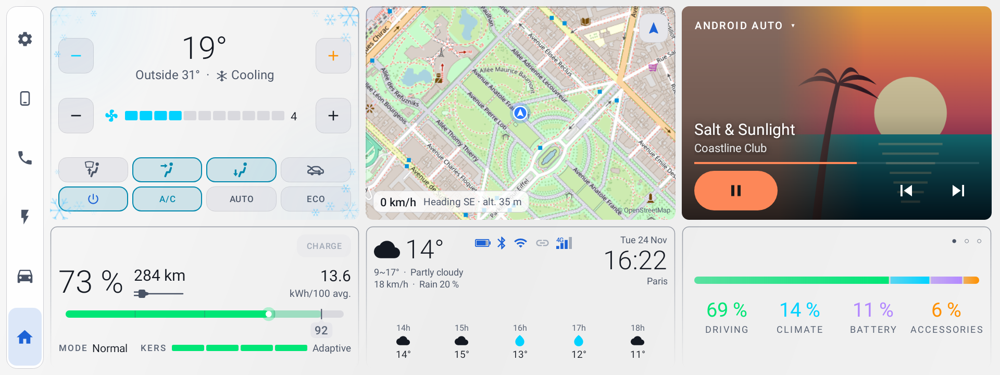

The default home screen (*Standard* style, *Full* layout) shows, from left to right:

- **The bar**: Settings, Phone, Energy, Vehicle and Home, vertical on the driver's side by default. Each icon also has a long press or a double tap, see [Gestures](#gestures).
- **Climate**: set temperature and outside temperature, fan, power, A/C, AUTO, ECO, air directions and recirculation, and heated seats and wheel on equipped cars.
- **Energy**: battery % to the tenth, range, average consumption, drive mode and the regeneration gauge.
- **App card**: the OpenStreetMap map following the car, or another app of your choice.
- **Weather**: forecast for the car's position, by hour or by day, with the connection icons.
- **Media**: the source playing, with its picture.
- **Trip, power or phone**: the bottom-right card; swipe it for the next one.

MG4Dash is always full screen: the SAIC side bar and the top bar stay hidden, also during calls.

<details>
<summary>Climate card details</summary>

- Fan minus at the lowest speed turns the climate off; a long press on it jumps to the lowest speed.
- Long press **A/C** for intermittent A/C: the compressor runs and rests in cycles; tap A/C to stop.
- Tap the temperature area for the Climate page.
- Long press the power button for [Keep climate on](#keep-climate-on).
- **Long press the card** for its settings: calibration of the displayed set point (−5° to +5°, display only), the intermittent A/C cycle times, the heating / cooling shown on the card, heated seats and wheel (auto, yes, no), Keep climate on, and on old firmwares, keeping MG4Dash in front of the SAIC climate screen.

</details>

<details>
<summary>Energy card details: range, consumption sources and live power</summary>

The **range bar** is green, orange below 30 % and red below 15 %; the % at the start of the trip is marked on it.

A tap on the right half of the card changes the consumption shown, and the range follows it. A small logo says which one is shown:

| Logo | Consumption | Range |
|---|---|---|
| lightning bolt | since the last charge | energy left ÷ this consumption |
| route | current trip | same |
| live | the last km, sliding | same, it moves more |
| car | the one the car's range assumes | the car's own range |

Energy left is the charge level × estimated battery health × usable capacity when new (Energy page). A consumption not known yet (under 0.5 km) shows "—". The energy is measured every second from battery voltage × current, regeneration deducted.

**Long press the card** for its settings:

- *Live power in the energy card*: a live power bar replaces the drive mode and the gauge.
- *Voltage and current under the power bar*.
- The map layout's stack going back to the battery when plugged in.
- *Start V2L when the cable is plugged in*.

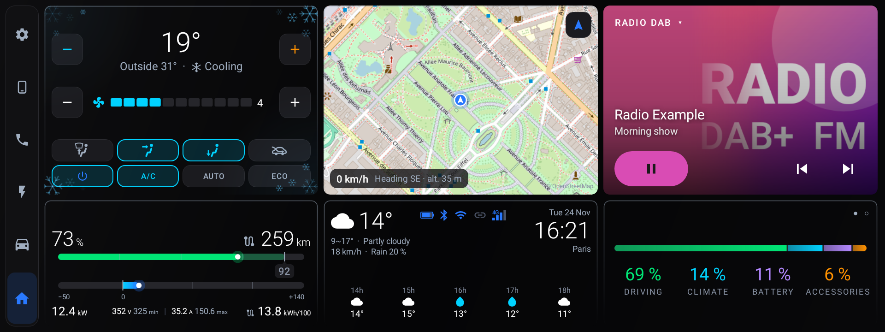

</details>

## Cards: what each one shows

Every place of the home screen holds one or more cards; a swipe on a place shows its next card. Long press a card for its settings.

| Card | What it shows | Long press |
|---|---|---|
| **Climate** | Temperature, fan, air, heated seats | calibration, intermittent A/C, Keep climate on |
| **Energy** | Battery, range, consumption, drive mode, regeneration | live power, voltage and current, V2L |
| **App** (map) | OpenStreetMap map following the car, or another app | zoom, map colours, offline switch; menu of apps |
| **Consumption** | Consumption curves by trip, since the last charge or over 12 months | periods, consumption at rest, clear the curve |
| **Shortcuts** | Apps and Home Assistant actions | Home Assistant settings |
| **Web app** | A web page of your choice (a Home Assistant dashboard, ABRP…) | its addresses |
| **Weather by hour / by day** | Open-Meteo forecast | weather model, fallback city |
| **Trip** | Trip energy: driving, climate and accessories | |
| **Power** | Live kW, peak, average; full-throttle effects | MG4 XPower, effects and their sound |
| **Phone** | Favourite contacts; tap to call | |
| **Recent trips** | Current trip, previous trips, today | |
| **Driving** | Drive mode, regeneration, Custom mode steering and brake pedal, lane keeping and collision warning, changed from the card | |
| **Speed cameras** | Speed limit and speed camera zones | [the whole alerter](#speed-camera-alerter) |
| **Guidance** | Turn-by-turn from MG4Link / Headunit Revived | |

| | | |
|---|---|---|
| 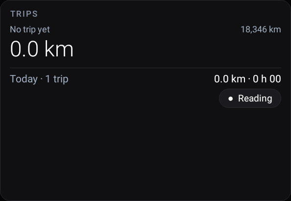 | 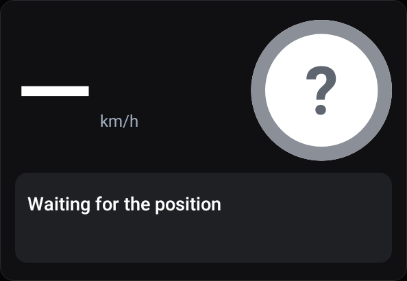 | 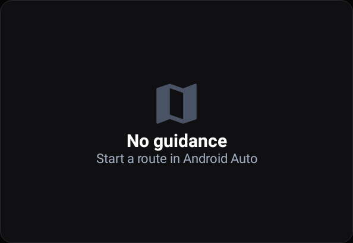 |

<details>
<summary>App card: the map, another app, full screen and the detached window</summary>

- **Map**: follows the car, north up or heading up (tap the recenter button again). At rest a one-finger swipe changes card; touch the map once to wake it (its outline lights up), then one finger moves it and two fingers zoom. Without a data connection the map stays while the area is in the tile cache, then home can switch to the energy card (optional).
- **Another app**: long press the card and pick the OpenStreetMap map, one of the last 3 apps or *Other app…*, for example ABRP or Waze. It runs live inside the card and rests and wakes like the map.
- **Full screen**: a double tap enlarges the card over the screen; a double tap, Home or any bar button brings it back.
- **Detached window** (off by default): in the edit mode, *Double tap on the app › Detached window* makes the double tap take the card out of its place into a window over home. Long press it › *Move / resize* to move it, pull a corner or a side, or use two fingers, then OK.
- **Turn-by-turn**: with [MG4Link](https://github.com/Skittle6938/MG4Link) or another Headunit Revived-based app, the next manoeuvre shows over the map. The stock Android Auto app does not give this information.

| EV route planner in the App card | Navigation banner over the map |
|---|---|
| 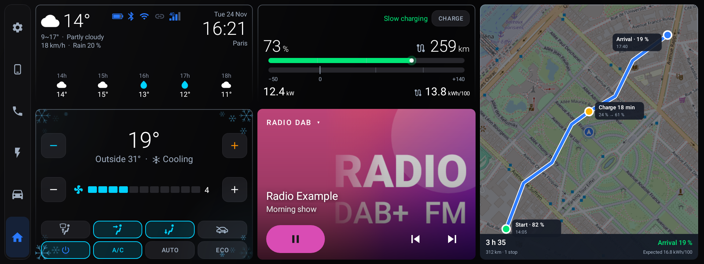 | 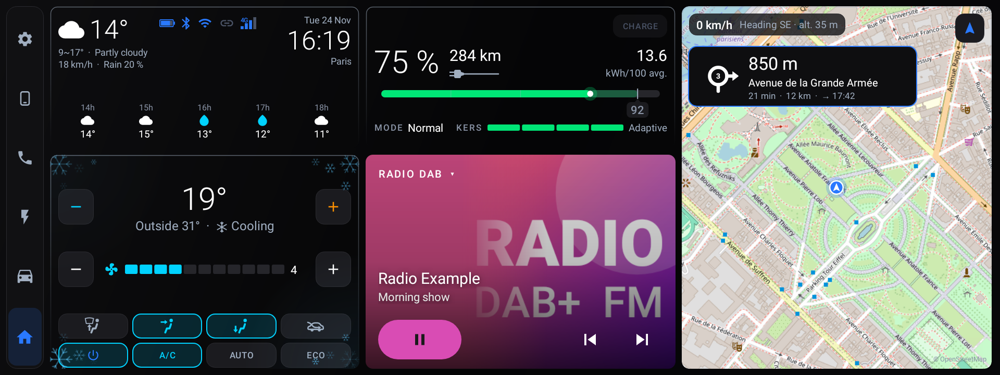 |

</details>

<details>
<summary>Consumption, shortcuts and web app cards in detail</summary>

- **Consumption**: a tap goes to the next period: since the last charge, current trip, or the last 12 months. The dashed line is the average (energy out of the battery minus regeneration, over the distance). *Regen* shows the energy recovered and the part of the distance it powered.
- **Shortcuts**: apps or Home Assistant actions (scripts, automations, scenes, gate, garage door…), 4 to 32 by the size of the place. Tap an empty slot or long press a slot to change it. A Home Assistant shortcut shows its live state under its name. The Home Assistant address and token are in the card's long press › *Home Assistant settings*: type them with Dash's keyboard, or import them from a `mg4dash_ha.txt` file at the root of a USB stick (address on one line, token on another).
- **Web app** (off by default): turn it on in the edit mode and touch its line for its list of addresses. At rest it behaves like the other cards; touch it once to use it as in a browser. On the car the page is shown by *MG4Dash Web*, a small app embedded in MG4Dash (Android refuses web pages to an app with system rights). Many recent sites need the [recent web engine](#updates-backups-and-companion-apps).

| Consumption | Shortcuts |
|---|---|
| 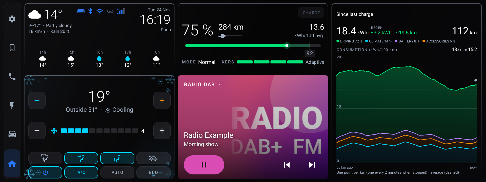 | 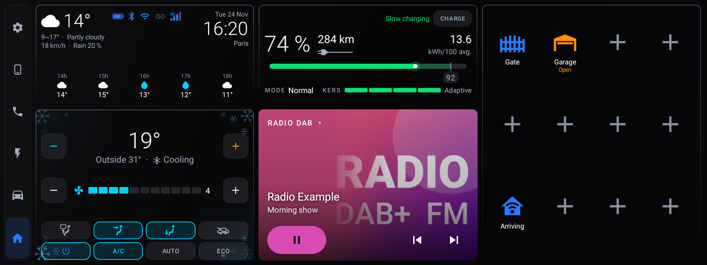 |

</details>

## Arrange the home screen

**Choose the cards of each place**: pinch the home screen with two fingers, or Settings › **Screen** › *Edit the layout and the widgets*. Each place shows what it can hold:

- a **medium place** shows the climate, the media, or cards in turn;
- in a place of **cards**, touch a card to add it there or remove it (a card is in one place at a time);
- **Default** puts the layout back as it was; **Done** closes the edit mode.

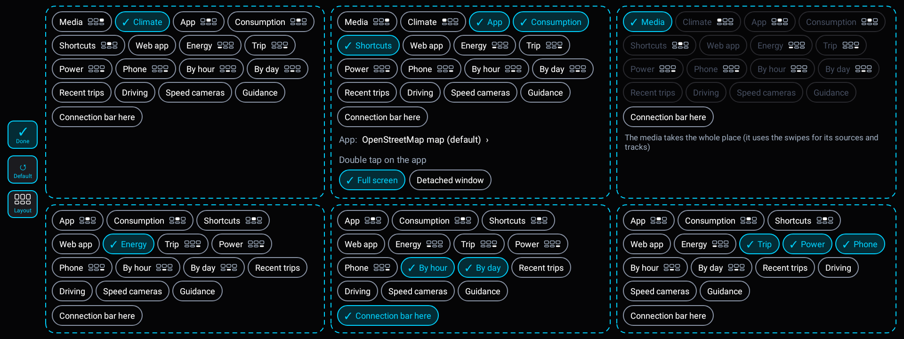

**Cards offered**: Settings › **Screen** › *Cards offered…* lists every card, in three columns sorted by name. Untick the ones you never use: they leave the home screen and the edit mode, and come back where they were when ticked again.

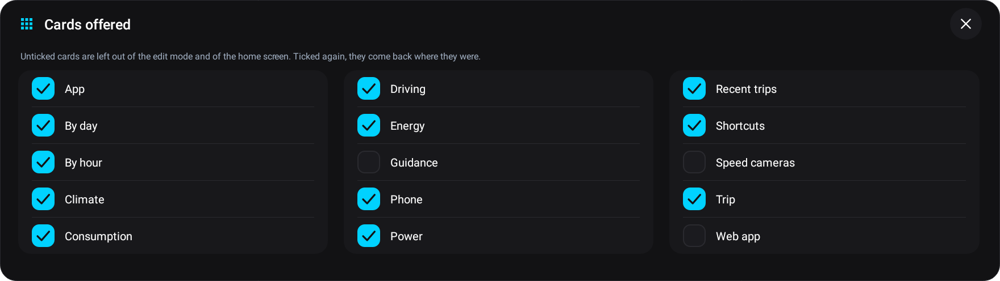

**Home styles** (Settings › **Screen** › *Home layout*):

- **Standard**: eight layouts: *Full* (default), the map on the right, left or in the centre, a big square on the left or right, a band at the top or bottom.
- **Large display** (*Grand affichage*): everything a third bigger, with stronger contrast. Seven layouts of two to four places (*Four* by default). The *Large display* tile of the shortcuts menu switches it on and off.
- **Simple**: fewer buttons and bigger text, with no cards to choose.

| Large display, *Four* | Standard, map on the right |
|---|---|
| 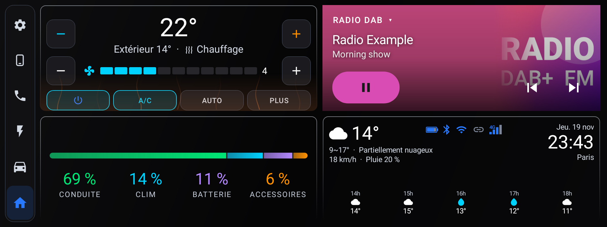 | 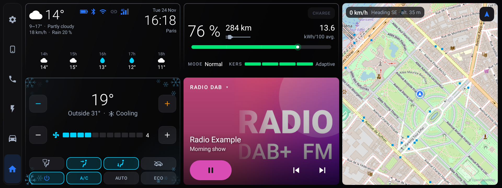 |

The **bar** can be vertical on the driver's side (default), forced left or right, or horizontal at the bottom with the clock; *Wide side bar* makes it twice as wide (Settings › **Screen** › *Bar*).

## Shortcuts menu

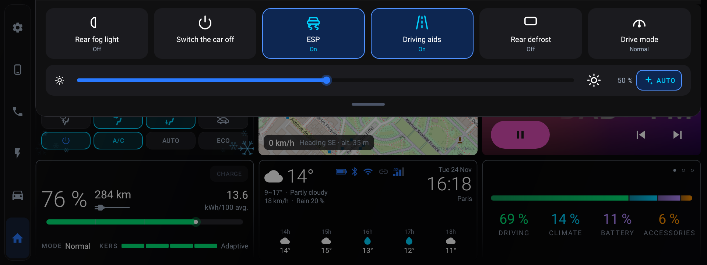

Slide one finger down from the very top of the screen. The panel follows the finger, over every MG4Dash screen and over other apps, Android Auto included. Slide it back up or touch beside it to close it.

- Each tile sends one command and shows the car's state: rear fog light, switch the car off (refused while driving), ESP, driving aids, rear defrost, drive mode, and to add: regeneration, one pedal, climate, battery preheat, heated wheel, doors, charge lock, V2L, screen off, cut Android Auto, ADB, profile, large display. Tiles the car does not support are not offered.
- **Long press** the menu to choose its tiles.
- **Screen brightness** under the tiles, with **AUTO** (see [brightness](#look-themes-colours-and-brightness)).
- Settings › **Screen** › *Shortcuts menu* (on by default) also hides MG's fog light button with an overlay, from the head unit's next start, and gives its corner back to the bar.

<details>
<summary>ADB from the menu</summary>

A home shortcut (long press a shortcut › *ADB*) and a menu tile turn on ADB over the USB port, as the car's adbutil app does. Settings › **System** › *ADB at start* (off by default) turns it on at each start. It goes off at the car's next start.

</details>

## Media, radio and Android Auto

The media card follows the car's active source (DAB / FM radio, Bluetooth, USB, Android Auto, CarPlay) and other apps playing music on the head unit.

- **Swipe** up / down for the next source, left / right for the next / previous track.
- **Tap the source name** for the source menu: it lists only the sources available now.
- **Tap the picture** to open the source's app; **long press play / pause** for the Sound page.
- **Open Android Auto from anywhere**: with a phone connected, slide one finger in from the left or right edge of the screen.
- **Cut the phone connection**: double tap the Android Auto button of the bar. The icon turns red and the phone stays on Bluetooth for calls and music; double tap again to bring Android Auto back.

**At startup** (Settings › **Media and sounds**): the *Source at startup* is *Automatic* by default (back to the last source still available), the car's choice, or a fixed source. *Playback at startup* resumes as when the car was switched off, always paused or always playing. The startup sequence and the startup sound wait until the car is really in use: screen on, and READY, the doors unlocked or a touch on the screen. Opening the boot of a locked car plays nothing ([#133](https://github.com/Skittle6938/MG4Dash/issues/133)).

<details>
<summary>Steering wheel, other apps and the Android Auto button</summary>

- **Steering wheel** left / right change track on the source shown, apps included. The car still hands these buttons to its last own source (often the radio); MG4Dash puts the radio back on its station and returns to the app at once.
- **Other apps** playing music (MG4Link, SimpMusic…) are offered as sources. Switching to an app sends it play, leaving it pauses it.
- **The Android Auto button of the bar** (Settings › **Media and sounds**) opens the original Android Auto, CarPlay or another app such as MG4Link.
- With **MG4Radio** on SWI69, DAB and FM can be two separate sources, and the AM band can be added.
- A **startup sound** of your own (an audio file from a USB stick or the internal storage, 30 s and 20 MB at most) can play when the car starts, with its own volume (Settings › **Media and sounds**).

</details>

## Pages: climate, energy, vehicle, sound, phone, trips

### Climate

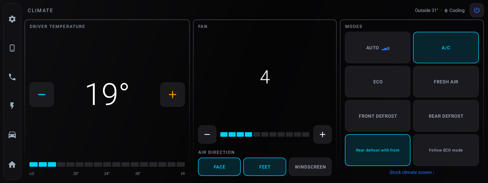

Temperature, fan, combinable air directions, AUTO, A/C, ECO, recirculation, front and rear defrost. Open it from the temperature area of the climate card.

### Keep climate on

A camp mode for when you are away or sleeping in the car: long press the climate power button. Turn it on first in the climate card's settings (long press the card). It runs **now** (for a set time or without limit) or **at a set time**, in one or more runs.

- After a countdown, **MG4Dash locks the doors itself**: get out and take the key. Do not lock with the key fob, which switches the whole car off.
- A large status screen stays readable from outside.
- It ends after the last run, at the end of the set time or below 20 % battery, and stops when the doors are unlocked or the car drives off.
- **Never leave a child or an animal alone in the car**: the climate can stop at any time.

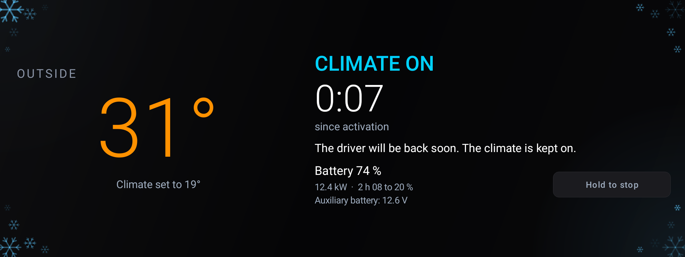

### Energy

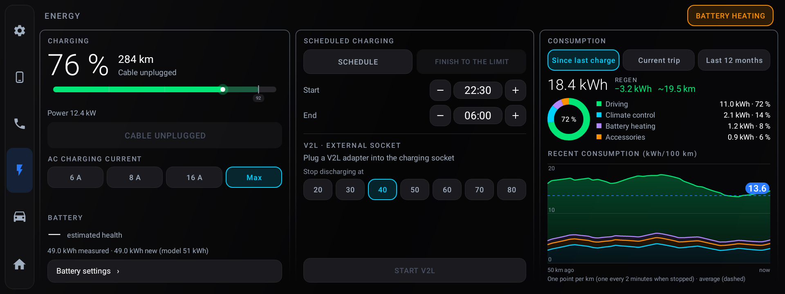

Charging (start / stop, charge limit where the car applies it, current, time left, cable lock), scheduled charging, V2L, battery heating, and consumption by period with the share of driving, climate, battery heating and accessories.

The **battery** section estimates the battery's health: while driving, MG4Dash measures the energy taken from the battery against the drop in %, and from a 15 % drop gives a dated measurement of the usable capacity. Its window (tap the battery section) sets the battery model and your own capacity when new. This is an estimate, not an official measurement.

### Vehicle

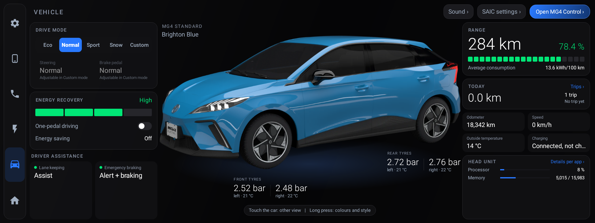

Drive mode (Eco, Snow and Custom where available), regeneration (level 6 is one-pedal driving), driver assistance, tyre pressures and temperatures, the car's state, and the running apps of the head unit (tap the head unit section): each app's processor and memory use, refreshed every 3 s.

### Sound

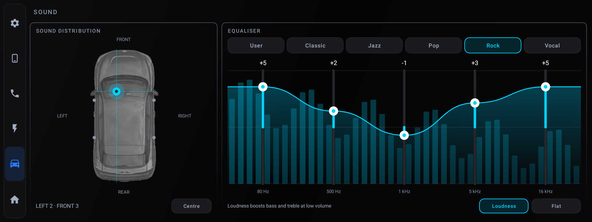

Open it from the Vehicle page or with a long press on play / pause. Drag the dot on the car to set balance and fader; 5-band equaliser with the car's presets or your own curve. These are the car's own settings.

### Phone

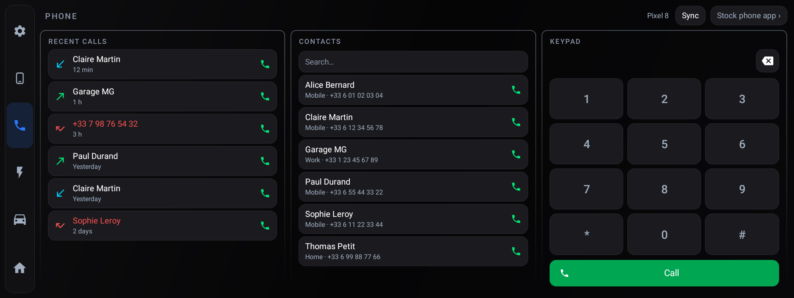

Recent calls, contacts with search and a keypad, from the phone connected over Bluetooth. The stock in-call screen is kept.

### Trips

Every trip with its distance, energy and consumption. The *kWh price* button gives each trip its cost. Open it from the Recent trips card.

## Settings

Tap the **gear** on the bar. Settings has five tabs; the profile menu (*Profile: Main ▾*) sits beside them, and the last tab used opens next time. Every window has the same design: a title, grouped rows, switches, a round ✕ at the top right, and a touch outside or the Home key closes it.

| Tab | What you find there |
|---|---|
| **Screen** | Home style and layout, edit the layout and the cards, *Cards offered*, the gesture tour, the bar (position, wide bar), the shortcuts menu |
| **Look** | Light, dark or automatic, night after sunset, panel outline, background and button colours (24 each), brightness |
| **Media and sounds** | Source and playback at startup, the Android Auto button of the bar, the startup sound, MG4Radio's bands (with MG4Radio) |
| **General** | Units, tyre pressure unit, clock, MG4Dash keyboard, 4G data of the last 30 days and its detail |
| **System** | Replace SAIC home, maintenance mode, updates, settings backup, diagnostics (compatibility test, log, ADB at start, energy data recorder) |

| Screen | Look |
|---|---|
| 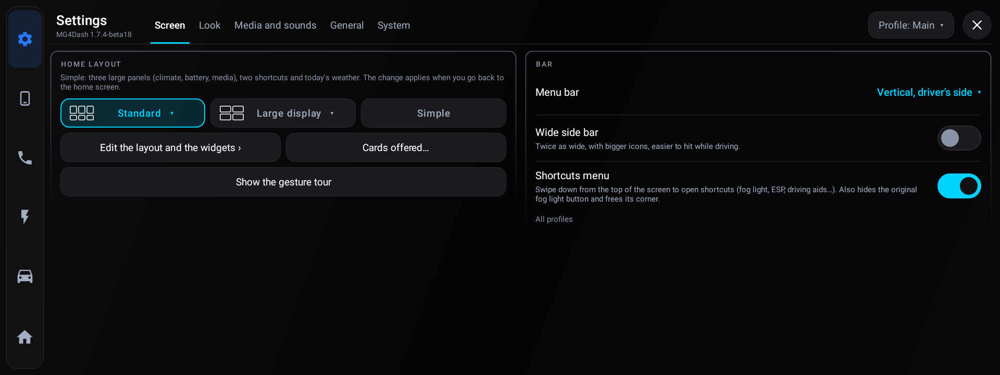 | 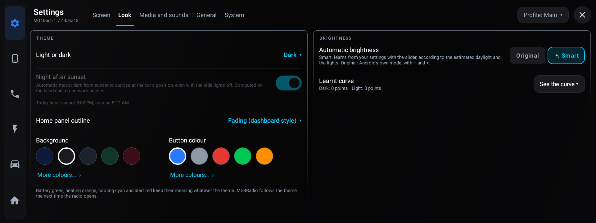 |
| **Media and sounds** | **General** |
| 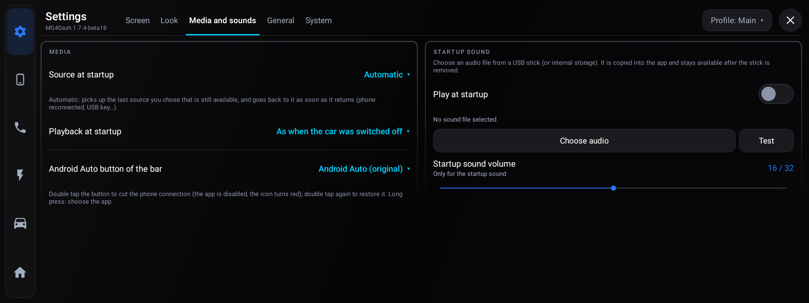 | 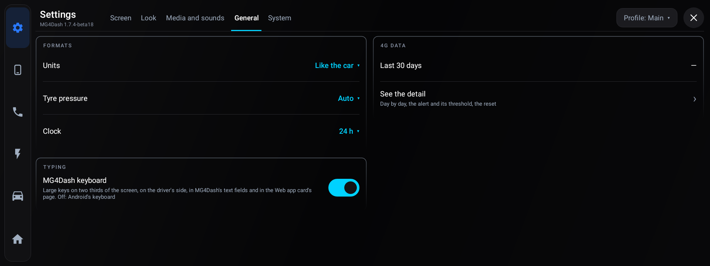 |
| **System** | |
| 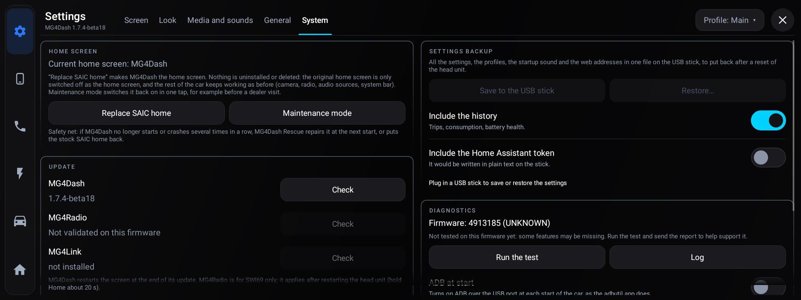 | |

**Settings that moved to their card or page** (long press the card):

| Setting | Where |
|---|---|
| Climate calibration, intermittent A/C, heated seats and wheel, Keep climate on | Climate card |
| Live power in the energy card, voltage and current, V2L | Energy card |
| MG4 XPower, full-throttle effects and their sound | Power card |
| Map zoom, map colours, switch to the energy widget when offline | App card (long press › gear) |
| Consumption at rest, clear a curve | Consumption card |
| Weather model, fallback city | Weather cards |
| Home Assistant address, token, test, USB import | Shortcuts card |
| Everything about the speed camera alerter | Speed cameras card |
| kWh price | Trips page |
| Battery model, capacity when new | Energy page › battery |
| Drive mode and regeneration kept by profile | Profile window |

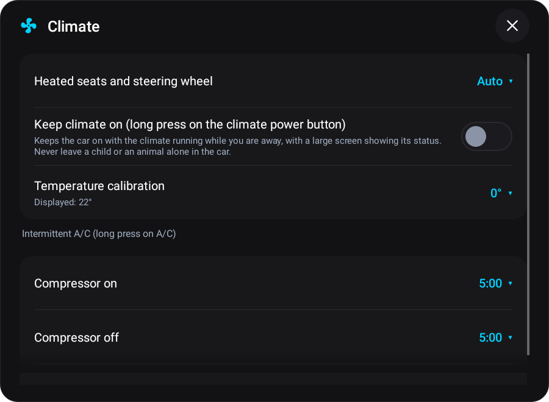

<details>
<summary>The MG4Dash keyboard</summary>

Text fields in MG4Dash use its own keyboard with large keys (AZERTY in French, QWERTZ in German, QWERTY otherwise). Long press a letter for its accents, long press shift to keep it on, long press delete to clear the field. The web app card's page uses it too. Settings › **General** › *MG4Dash keyboard* goes back to Android's keyboard.

</details>

<details>
<summary>Weather: city search and models</summary>

The weather follows the car's position. Long press a weather card:

- *Fallback city* (used when the position is not known): *Current position*, or *Search for a city…*, typed with Dash's keyboard.
- *Weather model*: *Automatic* picks the best model for your region; you can also force Météo-France, European (ECMWF), German (DWD), British (Met Office), American (NOAA) or Canadian (GEM). Only force one if the forecast is often wrong.

When a refresh fails (no data connection) the last forecast stays for up to 3 hours.

</details>

<details>
<summary>4G data</summary>

Settings › **General** shows the car's 4G data over the last 30 days. *See the detail* opens it by use and by day, the Wi-Fi's too, with an optional monthly quota and an alert.

</details>

## Look: themes, colours and brightness

**Theme** (Settings › **Look**): **Auto** (default, follows the car's lights), **Dark** or **Light**. In Auto, *Night after sunset* (on by default) makes it dark from sunset to sunrise at the car's position, computed on the head unit. The switch waits for stable lights and fades smoothly.

**Colours**: 24 backgrounds and 24 button colours, the first ones on the tab and *More colours…* for the whole grid. They apply to every page and to [MG4Radio](https://github.com/Skittle6938/MG4Radio). Battery green, heating orange, cooling cyan and alert red keep their meaning.

**Brightness** (Settings › **Look** › *Brightness*): *Smart* is the default, *Original* is Android's own automatic mode. The car's light sensor gives Android no real reading, so the smart mode estimates the light outside from the sun's height at the car's position, the cloud cover of the forecast and the side lights. Each correction you make with the brightness bar of the shortcuts menu becomes a point of its curve.

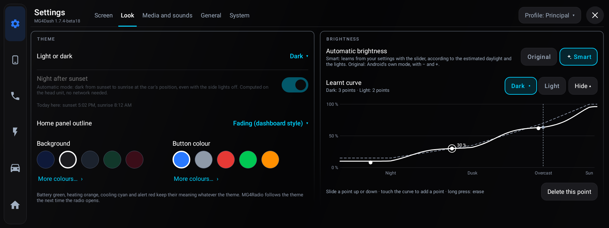

<details>
<summary>The brightness curve in detail</summary>

By default the curve gives 15 % at night, 35 % at dusk, 70 % on a grey day and 100 % in full sun. Leave a correction 4 s and it becomes a point; the curve stays smooth and rising. *See the curve ▾* shows it: slide a point, touch the curve to add one, select a point and *Delete this point*. **Dark | Light** picks the curve shown: each look and each profile has its own. A long press on an empty part of the graph erases this curve or both.

</details>

## Profiles

Up to 5 profiles, for several drivers or several ways of driving, from the **Profile: Main ▾** menu at the top of Settings or the *Profile* tile of the shortcuts menu. Each profile keeps its own home (style, layout and cards, shortcuts), its look, its brightness curves, its audio source at startup, its map and web app, its Home Assistant, its weather city, its units and clock, and its speed camera alerts. Updates, ADB, maintenance mode, the energy data and the trips stay shared.

- *New profile*: a name, started from the current profile or from the defaults.
- *Phone paired* (optional): at the first connection of this phone after a start, MG4Dash switches to its profile by itself.
- *Take back this profile's drive mode and regeneration* (in the profile's window, per profile): leaving the profile, MG4Dash notes the drive mode and regeneration; switching back to it, it puts them back.

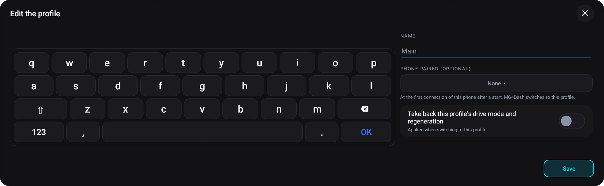

## Speed camera alerter

Place the **Speed cameras** card on the home screen (pinch the home screen). It shows the speed limit of the road and warns you in speed camera zones, from [OpenStreetMap](https://www.openstreetmap.org/copyright) data only. The alerter runs while the card is in a place, even when another card is shown, and its alerts show over Android Auto.

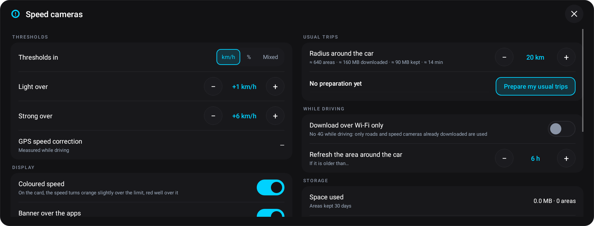

**Long press the card** for all its settings, in one window:

- **Thresholds**: a light (orange) and a strong (red) alert above the limit, in km/h, % or mixed, set with − and + or typed exactly; a GPS speed correction.
- **Display**: *Coloured speed* on the card, and the *Banner over the apps*, shown only when you are over the limit in a camera zone (strong alert).
- **Sounds**: one per alert, among 9 sounds or none; touch a sound's row for its volume and its repeat.
- **Usual trips**: *Prepare my usual trips* downloads in advance the zones within 5 to 50 km around the car, so they are ready offline.
- **While driving**: download over Wi-Fi only, and how often an area is refreshed.
- **Storage**: the space used, and *Clear*.

## Updates, backups and companion apps

**Updates** (Settings › **System**): one line each for MG4Dash, MG4Radio and MG4Link, with the installed and latest versions. *Install* shows the release notes and installs. *Check automatically* (on by default) looks once a week, or every day with *Include beta versions*. A new official release is also offered on the home screen. A download cut by the network goes on where it stopped. Since 1.7.4, the published app is shrunk with R8: about 8.6 MB instead of 14.9 MB.

**Settings backup** (Settings › **System**): *Save to the USB stick* writes every setting, the profiles, the startup sound and the web addresses to `mg4dash_settings_YYYYMMDD_HHMM.json` at the root of the stick. *Include the history* adds the trips, consumption and battery health; *Include the Home Assistant token* adds the token, in plain text. *Restore…* lists the backups on the stick; MG4Dash replaces its settings and restarts.

<details>
<summary>MG4Radio, the recent web engine and uninstalling</summary>

- **[MG4Radio](https://github.com/Skittle6938/MG4Radio)** is the radio redesigned in the MG4Dash style. It installs from the same page on **SWI69 only**, where it replaces the stock radio. Restart the head unit afterwards by holding Home about 20 s.
- **Recent web engine**: a third line installs Chromium 138 over the car's own WebView (Chromium 66), so that today's sites open in the web app card (ABRP, Waze…). It is a 243 MB download from [MG4Dash-WebView](https://github.com/Skittle6938/MG4Dash-WebView), best over Wi-Fi. *Back to the original* puts the car's engine back; site data is lost either way.
- *Uninstall MG4Dash, MG4Radio or MG4Link…* is on the same page. Put the SAIC home back first with Maintenance mode.

</details>

## Maintenance mode and going back to the SAIC home


Settings › **System** › **Maintenance mode** puts the SAIC home screen back in one tap, exactly as before: for a dealer visit, a problem, or before uninstalling.

- **Back to MG4Dash**: slide **three fingers** down from the top of the screen, over the SAIC home or any app, and tap **Back to MG4Dash** on the small banner. Choosing MG4Dash as the home app in Android's settings works too.
- While in maintenance mode, nothing of MG4Dash reacts: a shortcut or another app that opens one of its screens has it close at once.
- **Opened from another launcher's app list**, MG4Dash runs as a normal app and the SAIC home stays the home screen.
- If MG4Dash crashes 3 times within 3 minutes, the SAIC home comes back by itself.

## Gestures

The most useful ones; the [gesture tour](#first-steps) shows them on screen.

| Gesture | Where | What it does |
|---|---|---|
| Long press | any card | its settings |
| Pinch with two fingers | home screen | choose the cards |
| One finger down from the top | anywhere | shortcuts menu |
| One finger in from the left or right edge | anywhere | Android Auto, when a phone is connected |
| Double tap | Android Auto button | cut / restore the phone connection |
| Long press | Android Auto button | Android Auto, CarPlay or another app |
| Long press | gear | the car's settings |
| Swipe | a card place | next card |
| Swipe up / down, left / right | media card | next source, next / previous track |
| Double tap | App card, web app | full screen, or detach as a window |

<details>
<summary>All gestures</summary>

- Long press "Home" in the bottom dock: installed apps. Long press the clock: clock or Wi-Fi settings.
- Vertical bar: double tap Energy turns the screen off, long press Energy switches the car off (never while moving); double tap Vehicle locks / unlocks the doors, long press Vehicle turns ESC off / on.
- Tap the temperature area: Climate page. Long press fan minus: lowest fan speed. Long press A/C: intermittent A/C.
- Long press play / pause: Sound page. Tap the media card's source name: source menu.
- Tap a segment of the regeneration gauge: regeneration level; long press: one-pedal driving.
- Swipe the weather card: by hour ↔ by day.
- Long press a shortcut: edit it. Long press a phone favourite: change it.
- Long press the connection icons: choose which show (USB-A and USB-C are off by default).
- Steering wheel * button: 360 camera on / off.
- Two fingers down from the top over another app: back to MG4Dash's home. Three fingers over MG4Link's projection end its session.
- App card or web app: a touch wakes it (lit outline); long press: *Back*, *Move / resize* when detached, and what it shows.
- Map recenter button: follow the car again; press again for north up or heading up.

</details>

## Troubleshooting

<details>
<summary>"Phone is starting…" after an update</summary>

That is Android's own waiting screen, shown while MG4Dash is stopped and optimized after an update (about 50 seconds). From MG4Dash Rescue 9, an *Updating MG4Dash…* screen replaces it. MG4Dash comes back by itself.

</details>

<details>
<summary>MG4Dash no longer starts after an install</summary>

MG4Dash Rescue repairs it by itself: it recompiles and relaunches MG4Dash, and puts the SAIC home back if that is not enough. To uninstall MG4Dash, put the SAIC home back with Maintenance mode, then use Settings › **System** › *Uninstall MG4Dash, MG4Radio or MG4Link…*.

</details>

<details>
<summary>The SAIC home or a launcher chooser shows instead of MG4Dash</summary>

After an install, Android may ask which home to use: choose MG4Dash and *Always*. After a crash loop, MG4Dash's crash guard puts the SAIC home back; open MG4Dash from three fingers down › *Back to MG4Dash*.

</details>

<details>
<summary>A feature is missing on my car</summary>

The firmware probably does not expose it (see [Before you install](#before-you-install)). Run the compatibility test (Settings › **System** › *Diagnostics*) and open the issue it prepares.

</details>

## Build and propose a home card (widget)

A **card** (or widget) is what fills a place of the home screen. Every card follows one contract, so the home screen places it, sizes it, starts and stops it, and opens its settings on a long press, the same way for all. You only write the card.

### 1. Discuss it first

[Open an issue](https://github.com/Skittle6938/MG4Dash/issues/new?template=feature.yml) before coding: what the card shows, why it helps while driving, what it does in each size, and which data it needs (car, network, another app). We agree on the behaviour and the implementation choices there, so the pull request is quick.

### 2. The pieces you use

| Piece | File | Role |
|---|---|---|
| `HomeCard` | `app/src/main/java/app/mg4dash/cards/HomeCard.kt` | The contract: `card`, `view`, `place()`, `shown()`, `options()` |
| `HomeSlots.Card` | `app/src/main/java/app/mg4dash/ui/HomeSlots.kt` | The card's identity: id, name, icon, sizes |
| `HomeCards.factories` | `app/src/main/java/app/mg4dash/cards/HomeCards.kt` | One line that creates the card |
| `CardPlace` | `cards/HomeCard.kt` | The shape of its place: `small`, `medium`, `tall`, `wide`, `big` |
| `CardScope` | `cards/CardScope.kt` | What the card follows while shown, cancelled when hidden |
| `CardPrefs` | `cards/CardPrefs.kt` | Its settings, keys `card_<id>_<name>`, per profile and in the backup |
| `CardKit` | `cards/CardKit.kt` | Margins, title, text sizes, rows, dividers, buttons, "No data yet", in theme colours |
| `OptionsPopup` | `ui/OptionsPopup.kt` | The settings window of the long press: `toggle`, `check`, `choice`, `slider`, `stepper`, `action`, `note` |
| `Windows`, `Rows` | `ui/Windows.kt`, `ui/Rows.kt` | Any other window (`show`, `confirm`, `pick`) and its rows |
| `TemplateCard` | `app/src/testEmulator/java/app/mg4dash/cards/TemplateCard.kt` | A complete card to copy, rendered by the tests |

### 3. Step by step, with the Guidance card

The **Guidance** card (`ui/NavCard.kt`) is a good real example: it shows turn-by-turn guidance, adapts to every size, and only follows its data while shown.

**a. Copy the template.** Copy `TemplateCard.kt` to `app/src/main/java/app/mg4dash/cards/YourCard.kt`. It contains every part, in order.

**b. Declare it** with one entry in `HomeSlots.Card`:

```kotlin
NAV("nav", R.string.wc_nav, R.drawable.ic_map, big = true, manual = true),
```

`big = true` if it can fill a place two columns wide; `manual = true` so a new card only appears where the driver puts it.

**c. Register it** with one line in `HomeCards.factories`:

```kotlin
Card.NAV to ::NavCard,
```

That is all the wiring: no change in `MainActivity` or in the edit mode.

**d. Implement the contract.**

```kotlin
class NavCard(context: Context) : FrameLayout(context), HomeCard {
    override val card = HomeSlots.Card.NAV
    override val view: View get() = this

    // Size: read the shape of the place, never the screen
    override fun place(p: CardPlace) { form = formFor(p.size) }

    // Life: follow the data only while shown; everything stops when hidden
    private val follow = CardScope()
    override fun shown(on: Boolean) = follow.set(on) {
        launch { NavRepo.nav.collect { n -> show(n) } }
    }
}
```

- `place(p)` is called before the card is first shown and when it moves. Use `p.small`, `p.medium`, `p.tall`, `p.wide`; in the Large display (`p.big`) text is already bigger by itself.
- `shown(true)`: show the data at once, then follow it. `shown(false)`: stop collectors, timers and network. It may be called twice in a row.

**e. Settings.** Store them with `CardPrefs` and show them in `options()`, as the template does:

```kotlin
private val prefs = CardPrefs(context, card)
private var showRange: Boolean
    get() = prefs.bool("show_range", true)
    set(v) = prefs.setBool("show_range", v)

override fun options(popup: OptionsPopup): OptionsPopup =
    popup.toggle(context.getString(R.string.vh_range), null, { showRange }) { showRange = it; render() }
```

> [!WARNING]
> `options()` is also called once when the home screen is built, only to see whether the card has settings. That window is never shown, so **start nothing in `options()`**. Something live in the window (a refresh loop) starts when its view is attached and stops when it is detached. Return `null` if the card has no settings: it then takes no long press.

**f. Texts.** Every text the driver sees goes in `i18n/strings.psv` (key, then English, French, German, Spanish, Italian, Dutch, Turkish, Czech), then:

```powershell
python i18n/gen.py
```

**g. Try it in the app.** Build the emulator version, or install on the car, then pinch the home screen and touch your card in a place. If it doesn't show in the edit mode, check that it is ticked in Settings › **Screen** › *Cards offered*.

### 4. Reuse, for a consistent look and behaviour

- **Colours**: only the theme's, through `CardKit` or `Themes.color(context, R.color.…)`: `text_value` for values, `text_sub` for labels, `text_title` for the title, `panel_border` for dividers, `accent_action` for the accent. Never a fixed colour: the 24 backgrounds and accents, light and dark, then work by themselves.
- **Building blocks**: `CardKit.pad`, `CardKit.title`, `CardKit.text` (17, 44, 22 and 18 sp), `CardKit.row`, `CardKit.divider`, `CardKit.empty`.
- **Windows**: `OptionsPopup` for the card's settings and `Windows` for anything else, with `Windows.confirm` for a question. They bring the title, the round ✕ and the rows; no *Close* or *OK* button.
- **Touch**: make the whole card clickable (`isClickable = true`) so that a swipe on it still changes card. A tap may open the related page; a long press opens the settings.
- **Data**: car data from `CarBridge.state`, media from `MediaHub`. Use mobile data only while shown, and keep it small.
- **Safety**: nothing to read at length or type while driving, no animation that grabs the eye.

### 5. Tests to add

Cover these states: **no data yet**, loading, with data, an error (network or car value missing), **every size** the card accepts, **shown and hidden** (nothing runs when hidden), and its settings window.

| Test | What it checks |
|---|---|
| A unit test for the card's logic (Robolectric, like `HomeCardsTest`) | formatting, computations, the states above, `shown(false)` stops everything |
| `CardGalleryShots` | renders every registered card in every size it accepts, dark and light, into `app/build/screenshots/cards/`: nothing to add, it picks your card from `HomeCards.factories` |
| `WindowsFitTest` | every card's settings window fits the 1920 × 720 screen, in normal and Large display |
| `CardOptionsTest`, `HomeCardsTest` | the long press opens the window; the card is the one it is listed for; its settings keys follow the profile |

Commands, from the repository root:

```powershell
.\gradlew.bat testEmulatorDebugUnitTest
.\gradlew.bat testEmulatorDebugUnitTest -Pscreenshots --tests app.mg4dash.cards.CardGalleryShots
.\gradlew.bat testEmulatorDebugUnitTest --tests app.mg4dash.WindowsFitTest
python i18n/gen.py --check
```

The first runs every unit test (no screenshots); the second writes your card's pictures to `app/build/screenshots/cards/`; the third checks its settings window; the last checks the translations.

| The template card, in a medium place, dark | and light |
|---|---|
| 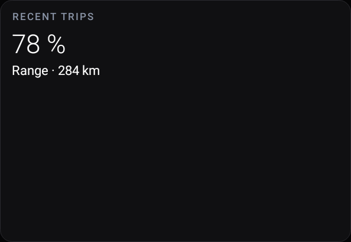 | 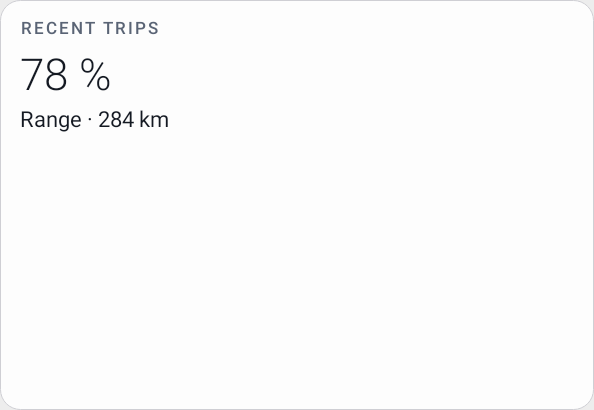 |

### 6. Submit it

Open a pull request with one card per PR, and say in it:

- what the card adds and for whom;
- how to try it (where to place it, what data it needs);
- which tests you ran and their result;
- a screenshot when it helps, from `app/build/screenshots/cards/` (dark and light).

The CI builds it, runs the tests and lint, and checks the translations. More rules (settings keys, code comments) are in [CONTRIBUTING.md](CONTRIBUTING.md).

## Build MG4Dash from source

```powershell
.\sign_platform.ps1                       # signed car build → dist\MG4Dash-<version>.apk
.\gradlew.bat testEmulatorDebugUnitTest   # unit tests on the emulator flavour
.\gradlew.bat testEmulatorDebugUnitTest -Pscreenshots   # screenshots only → app\build\screenshots\
python i18n/gen.py                        # regenerate the translations after editing i18n\strings.psv
```

The car build needs the AOSP platform key, which is not in the repository (the car's own apps use the same public test key):

```powershell
$u = "https://android.googlesource.com/platform/build/+/refs/tags/android-9.0.0_r61/target/product/security/platform.pk8?format=TEXT"
[IO.File]::WriteAllBytes("keys\platform.pk8", [Convert]::FromBase64String((Invoke-WebRequest $u -UseBasicParsing).Content))
```

Release builds are shrunk and optimised with R8, keeping every class and member name (`app/proguard-rules.pro`), so anything reached by name keeps working.

<details>
<summary>Project layout</summary>

- `app/src/main/java/app/mg4dash/`: the app (Kotlin)
  - `cards/`: the card contract, the card list and the building blocks
  - `car/`: vehicle access (`CarBridge`, `CarProps`, `LegacyCar` for the old firmwares, `ReadyState`)
  - `energy/`: energy measured every second, consumption curves, battery health
  - `media/MediaHub.kt`: active player and audio sources, startup sequence, steering wheel for apps
  - `radar/`: the speed camera alerter (OpenStreetMap data through Overpass)
  - `settings/`: the Settings page, profiles, Home Assistant window, compatibility report
  - `ui/`: home screen pieces, windows (`Windows`, `Rows`, `OptionsPopup`), themes
  - `system/`: firmware detection, updates, Rescue link, backup, maintenance mode
- `app/src/car/`: car manifest (`sharedUserId=android.uid.system`) and the embedded `rescue.apk`, `web.apk`
- `app/src/emulator/`: build without the system uid, with simulated data
- `rescue/`: MG4Dash Rescue, the safety net
- `web/`: MG4Dash Web, which shows the web app card's page on the car
- `i18n/`: translations (`strings.psv`) and their generator
- `keys/`: the AOSP platform test certificate

`rescue/` and `web/` are built apart (`.\gradlew.bat :rescue:assembleRelease`, `.\gradlew.bat :web:assembleRelease`), signed with the platform key, and their APK is committed in `app/src/car/assets/`. Raise the version in `system/Rescue.kt` or `system/WebViewer.kt` with the module's, so that MG4Dash installs the new one.

</details>

<details>
<summary>GitHub Actions</summary>

- **PR check**: unit tests, emulator and car builds, Android lint, translations and version progression. Its summary lists test results, lint findings and APK sizes.
- **R8 smoke test**: opens every page of the shrunk build in an Android 9 emulator; any crash fails it.
- **UI previews**: renders representative screens in dark, light and large display, plus the startup animation.
- **Publish beta**: run by hand on `main` with a version and release notes. It tests, runs the R8 smoke test, keeps the R8 mapping with the run, signs and publishes a prerelease. *dry_run* builds and verifies without publishing.

</details>

## Credits, support and licence

- [MG4Control](https://github.com/SliDeeN/MG4Control) (SliDeeN): the A9 car API path.
- [MG4-Custom-Launcher](https://github.com/adammcdonagh/MG4-Custom-Launcher) (adammcdonagh): Bluetooth album art, the AOSP test keys and the stock launcher SDK on SWI68.
- [MG4_Simple_Launcher](https://github.com/Tommasov/MG4_Simple_Launcher) (Tommasov): notes on the vehicle adapter service of other firmwares.
- Maps and speed camera data © [OpenStreetMap](https://www.openstreetmap.org/copyright) contributors ([ODbL](https://opendatacommons.org/licenses/odbl/)), through osmdroid and the [Overpass API](https://wiki.openstreetmap.org/wiki/Overpass_API). Weather by [Open-Meteo](https://open-meteo.com/).

**Support**: MG4Dash is free and will stay free. If it is useful to you, you can leave a few euros on [Ko-fi](https://ko-fi.com/skittle6938). Entirely optional, thank you!

**Licence**: free software under the [GNU General Public License v3](COPYING) or later, for every published version. Parts of the firmware detection and of the old firmwares' climate code are adapted from [MG4Control](https://github.com/SliDeeN/MG4Control) (GPL v3; earlier code under the MIT licence, notice in [licenses/MG4Control-MIT.txt](licenses/MG4Control-MIT.txt)). Personal project, not affiliated with SAIC / MG. Use at your own risk.

<details>
<summary>Appendix: MG4 battery capacities used by default</summary>

The most likely usable energy of a new battery, measured from 100 % until the car stops:

- **51 kWh LFP: about 50 kWh**; from 100 % to 0 % shown: about 49 kWh.
- **64 kWh NMC: about 62.5 kWh**; from 100 % to 0 % shown: about 61 kWh.
- **77 kWh NMC: about 74.5 kWh**; from 100 % to 0 % shown: about 72.5 kWh.

For range, rely on the "0 % shown" values: they are the ones MG4Dash uses by default. Your own can be set on the Energy page › battery.

</details>
